# Grouping Dry Bean Varieties Through Shape-Based Clustering

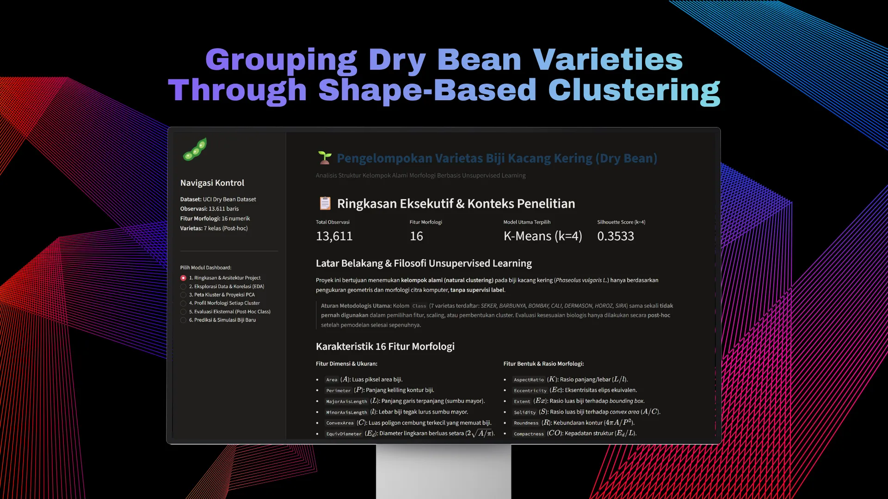


## Project Overview

This project implements a strictly unsupervised machine learning pipeline to discover natural morphological groupings across 13,611 dry bean (*Phaseolus vulgaris L.*) specimens using 16 geometric and shape features extracted from high-resolution digital images. Throughout data preprocessing, dimensionality analysis, model selection, and clustering, the ground-truth `Class` column representing seven registered varieties (`DERMASON`, `SIRA`, `SEKER`, `HOROZ`, `CALI`, `BARBUNYA`, and `BOMBAY`) is strictly isolated and opened only for post-hoc external validation. Four clustering paradigms—K-Means, Agglomerative Hierarchical (Ward linkage), Gaussian Mixture Models (GMM), and DBSCAN—are benchmarked systematically, paired with a reproducible Python pipeline, serialized artifacts, an exploratory Jupyter notebook, and an interactive Streamlit dashboard.

## Problem Statement & Objectives

Conventional seed sorting and supervised classification pipelines assign discrete administrative labels even when distinct bean varieties exhibit continuous, overlapping physical geometry, and they cannot automatically characterize unlabeled seed mixtures or novel breeding lines. Grouping specimens solely from measurable silhouette dimensions and shape ratios clarifies which biological varieties are naturally separable by geometry alone and where optical sorting systems require complementary color or texture sensors.

- Discover natural morphological clusters across 13,611 dry bean specimens using 16 quantitative shape and dimension features without label supervision.
- Compare four distinct clustering paradigms (centroid-based K-Means, hierarchical Ward linkage, probabilistic GMM, and density-based DBSCAN) using internal validity indices, cluster size balance, and subsampling stability.
- Characterize the physical and phenotypic profile of each discovered cluster using raw feature means and population-relative Z-scores.
- Evaluate post-hoc correspondence between unsupervised geometric clusters and the seven registered biological varieties (`Class`).
- Diagnose physical overlap boundaries and explain why geometrically similar varieties cannot be separated by binary silhouette features alone.

## Data & Input Sources

The study uses the **UCI Dry Bean Dataset** (UCI ID `602`, DOI: `10.24432/C50S4B`), originally introduced by Koklu & Özkan (2020) in *Computers and Electronics in Agriculture*. The dataset contains 13,611 specimen records and 17 columns: 16 numerical morphological features (12 dimensional measurements and 4 derived shape factors) plus 1 categorical `Class` label held out exclusively for post-hoc external validation. Data quality auditing confirms zero missing values, zero infinite values, and 68 exact duplicate feature rows (136 involved rows), all belonging to `HOROZ`; duplicate sensitivity testing (`ARI = 0.99905`) confirmed that retaining them preserves cluster topology.

| Attribute | Value |
| :--- | :--- |
| Dataset / Input Source | UCI Dry Bean Dataset (Koklu & Özkan, 2020) |
| Repository Path | [dataset/original/Dry_Bean.csv](dataset/original/Dry_Bean.csv) |
| Metadata Reference | [metadata.json](metadata.json), [dataset/original/metadata.json](dataset/original/metadata.json) |
| Format | CSV (`13,611` rows x `17` columns) |
| Samples / Records | `13,611` specimens (`DERMASON`: 3,546; `SIRA`: 2,636; `SEKER`: 2,027; `HOROZ`: 1,928; `CALI`: 1,630; `BARBUNYA`: 1,322; `BOMBAY`: 522) |
| Features / Input Shape | `16` numerical features (`Area`, `Perimeter`, `MajorAxisLength`, `MinorAxisLength`, `AspectRatio`, `Eccentricity`, `ConvexArea`, `EquivDiameter`, `Extent`, `Solidity`, `Roundness`, `Compactness`, `ShapeFactor1`–`ShapeFactor4`) |
| Post-Hoc Validation Column | `Class` (7 registered dry bean varieties, strictly excluded from training and feature scaling) |

## Data Preprocessing & Feature Engineering

Because Euclidean distance clustering is highly sensitive to feature scale—where `Area` spans `20,420` to `254,616` pixels while `Solidity` spans `0.919` to `0.995`—and because 21 feature pairs exhibit strong multicollinearity (`|r| >= 0.90`, led by `Area`–`ConvexArea` at `r = 0.99994` and `Compactness`–`ShapeFactor3` at `r = 0.99869`), dedicated scaling and dimensionality transformations are implemented in [src/preprocessing.py](src/preprocessing.py). Comparative experiments between `StandardScaler` and `RobustScaler` showed that `StandardScaler` better preserves the legitimate phenotypic separation of giant `BOMBAY` specimens rather than dampening them as noise, while PCA compresses the 16 standardized dimensions into interpretable morphological axes (`PC1` = `55.47%` overall size/scale; `PC2` = `26.43%` roundness vs. elongation; `PC1 + PC2` = `81.90%` cumulative variance; `4` components capture `95.02%`).

| Transformation | Input | Output | Role in Pipeline |
| :--- | :--- | :--- | :--- |
| `StandardScaler` (Z-score) | `16` raw numerical features (`13,611 x 16`) | Standardized matrix ($\mu = 0, \sigma = 1$) | Primary feature representation for all clustering models and PCA |
| `RobustScaler` (Benchmark) | `16` raw numerical features (`13,611 x 16`) | Median/IQR-scaled matrix | Alternative scaling benchmark evaluated at `k = 3, 4, 7` |
| Non-Redundant Feature Subset (`get_reduced_features`) | `16` standardized features | Curated `8` low-redundancy features (`Area`, `Perimeter`, `MinorAxisLength`, `AspectRatio`, `Solidity`, `Roundness`, `Compactness`, `ShapeFactor1`) | Collinearity sensitivity ablation at `k = 3, 4, 7` |
| Principal Component Analysis (`PCA`) | `16` standardized features | Full `16`-component variance profile and `2`-component projection (`PC1`, `PC2`) | Variance structure diagnostics and 2D cluster visualization |

1. Isolate the 16 numerical features (`X`) from the `Class` column (`y`) upon data loading in [src/data_loader.py](src/data_loader.py).
2. Fit `StandardScaler` on `X` without any label information and retain `RobustScaler` plus the 8-feature reduced matrix (`get_reduced_features`) for comparative ablation checks.
3. Fit full 16-component PCA to determine variance thresholds (`81.90%` at 2 components; `95.02%` at 4 components) and fit a 2-component `PCA(n_components=2, random_state=42)` transformer for downstream cluster mapping and interactive inference.

## Tech Stack

| Category | Technology | Purpose |
| :--- | :--- | :--- |
| Programming Language | Python | Core pipeline orchestration, statistical auditing, modeling, and dashboard development |
| Machine Learning & Preprocessing | Scikit-Learn | `StandardScaler`, `RobustScaler`, `PCA`, `KMeans`, `AgglomerativeClustering`, `GaussianMixture`, `DBSCAN`, `NearestNeighbors`, and clustering metrics |
| Data Manipulation | Pandas, NumPy | Tabular loading, data quality auditing, contingency crosstabs, and cluster profile aggregation |
| Scientific Computing | SciPy | Statistical computation support in analytical routines |
| Visualization | Matplotlib, Seaborn | 16 publication-grade exploratory, diagnostic, and evaluation figures |
| Interactive Dashboard | Streamlit | 6-module web interface for EDA, PCA cluster maps, morphological profiling, post-hoc validation, and new-specimen prediction |
| Artifact Serialization | Joblib, JSON, CSV | Persistence of trained `KMeans`, `StandardScaler`, and `PCA` models alongside structured evaluation tables |
| Interactive Notebook | Jupyter Notebook | Reproducible exploratory workflow documented in [notebooks/clustering_workflow.ipynb](notebooks/clustering_workflow.ipynb) |

## Machine Learning Approach

The project adopts a strictly **Unsupervised Learning** paradigm focused on tabular **Clustering** of geometric shape descriptors. Rather than optimizing predictive accuracy against predefined botanical labels, the methodology evaluates whether intrinsic density, centroid, or probabilistic structures emerge naturally in the 16-dimensional morphological space and then validates how those unsupervised partitions align with commercial varieties post-hoc.

| Attribute | Implementation Detail |
| :--- | :--- |
| Learning Paradigm | Unsupervised Learning |
| Problem Domain | Agricultural Computer Vision & Morphological Phenotyping |
| ML Task | Shape-Based Clustering & Cluster Profiling |
| Input Space | 16 standardized numerical geometric and shape descriptors (`13,611 x 16`) |
| Output | Hard/soft cluster assignments (`k = 4` primary macro-archetypes; `k = 7` comparative micro-clusters) and Z-score profiles |
| Evaluation Strategy | Internal metrics (Silhouette, Calinski-Harabasz, Davies-Bouldin), bootstrap subsampling stability, duplicate sensitivity, and post-hoc external validation (`ARI`, `NMI`, `Homogeneity`, `Completeness`, `V-Measure`, `Purity`) |

## Model Overview

Four distinct clustering algorithms are implemented in [src/models.py](src/models.py) and evaluated across a unified standardized feature matrix in [src/clustering_pipeline.py](src/clustering_pipeline.py). Based on internal cluster compactness/separation, bootstrap stability, and phenotypic interpretability, **K-Means (`k = 4`)** is selected as the primary natural-structure model, while **K-Means (`k = 7`)** is retained as a comparative benchmark matching the seven biological varieties.

| Model / Algorithm | Family | Configuration Scope | Role in Project |
| :--- | :--- | :--- | :--- |
| **K-Means (`k = 4`)** | Centroid-Based Partitioning | `n_clusters=4`, `init='k-means++'`, `n_init=20`, `max_iter=300`, `random_state=42` | **Primary Selected Model** representing 4 natural morphological macro-clusters |
| **K-Means (`k = 7`)** | Centroid-Based Partitioning | `n_clusters=7`, `init='k-means++'`, `n_init=20`, `random_state=42` | Comparative micro-cluster baseline aligned to 7 bean varieties |
| **Agglomerative Hierarchical** | Linkage-Based Clustering | `linkage='ward'`, `metric='euclidean'`, `k = 2..12` | Bottom-up hierarchical benchmark |
| **Gaussian Mixture Model (GMM)** | Probabilistic Mixture (EM) | `covariance_type='full'` and `'tied'`, `k = 2..12`, `random_state=42` | Soft probabilistic covariance-aware benchmark evaluated via BIC/AIC and internal scores |
| **DBSCAN** | Density-Based Clustering | `eps` in `[0.8, 1.0, 1.2, 1.5, 1.8, 2.0, 2.5]`, `min_samples` in `[15, 20, 30, 50]` | Density-manifold diagnostic test guided by `k = 32` k-distance curve |

## ML Workflow

The end-to-end analytical workflow is documented in [final_report.md](final_report.md), implemented modularly in [src/clustering_pipeline.py](src/clustering_pipeline.py), and mirrored interactively in [notebooks/clustering_workflow.ipynb](notebooks/clustering_workflow.ipynb):

1. **Data Loading & Quality Audit** ([src/data_loader.py](src/data_loader.py)): Load `Dry_Bean.csv`, isolate the 16 numerical features from `Class`, verify zero missing/infinite values, and inspect the 68 duplicate feature rows (`HOROZ`).
2. **Exploratory Data Analysis** ([src/eda.py](src/eda.py)): Compute descriptive statistics (mean, standard deviation, quartiles, skewness, kurtosis, `1.5 * IQR` outliers) and Pearson correlation matrices identifying 21 highly collinear feature pairs (`|r| >= 0.90`).
3. **Scaling & Dimensionality Reduction** ([src/preprocessing.py](src/preprocessing.py)): Standardize features with `StandardScaler`, prepare `RobustScaler` and reduced-feature benchmarks, and compute PCA variance ratios (`81.90%` in 2D, `95.02%` in 4D).
4. **Multi-Paradigm Clustering Experiments** ([src/models.py](src/models.py)): Train K-Means (`k = 2..12`), Hierarchical Ward (`k = 2..12`), GMM (`k = 2..12`, `full` & `tied`), and DBSCAN (28 parameter combinations), plus `RobustScaler` and reduced-feature ablations.
5. **Internal, Stability & Duplicate Sensitivity Evaluation** ([src/evaluation.py](src/evaluation.py), [src/clustering_pipeline.py](src/clustering_pipeline.py)): Score all models on Silhouette, Calinski-Harabasz, and Davies-Bouldin indices; test `k = 4` stability across 5 subsampling runs (`85%` sample ratio) and duplicate removal sensitivity.
6. **Post-Hoc External Validation & Morphological Profiling** ([src/evaluation.py](src/evaluation.py)): Cross-tabulate `k = 4` and `k = 7` cluster assignments against `Class`, compute `ARI`, `NMI`, `Homogeneity`, `Completeness`, `V-Measure`, and `Purity`, and aggregate mean/Z-score morphological profiles.
7. **Visualization, Artifact Export & Interactive Dashboard** ([src/visualization.py](src/visualization.py), [streamlit/app.py](streamlit/app.py)): Render 16 diagnostic figures to `figures/`, export `.joblib`, `.json`, and `.csv` artifacts to `models/`, and serve the 6-tab Streamlit exploration and inference app.

## ML Pipeline Architecture

The diagram below traces the implemented flow from raw specimen ingestion and strict label isolation through scaling, parallel multi-algorithm clustering, internal selection, post-hoc external validation, and artifact/dashboard consumption.

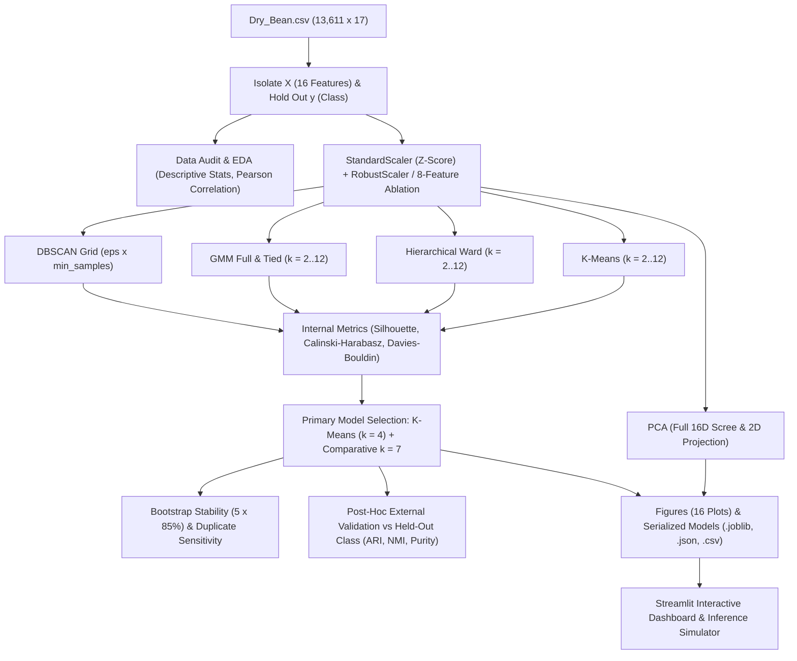

## Model Training & Configuration

All clustering algorithms are fit in an unsupervised manner on the `13,611 x 16` standardized matrix inside [src/clustering_pipeline.py](src/clustering_pipeline.py) and [src/models.py](src/models.py) using deterministic random seeds (`random_state=42`) where applicable.

| Component | Parameter | Configured Value | Notes |
| :--- | :--- | :--- | :--- |
| `StandardScaler` | Scaling method | Zero mean, unit variance | Fitted strictly on 16 numerical features `X` |
| `KMeans` (Primary & Sweep) | `n_clusters` | `4` (primary), `2..12` (sweep), `7` (comparative) | `init='k-means++'`, `n_init=20`, `max_iter=300`, `random_state=42` |
| `AgglomerativeClustering` | `linkage` | `'ward'` (`euclidean` metric) | Evaluated across `k = 2..12` |
| `GaussianMixture` | `covariance_type` | `'full'` and `'tied'` | Evaluated across `k = 2..12`, `random_state=42` |
| `DBSCAN` | `eps`, `min_samples` | `eps` in `[0.8, 1.0, 1.2, 1.5, 1.8, 2.0, 2.5]`, `min_samples` in `[15, 20, 30, 50]` | Guided by `NearestNeighbors(n_neighbors=32)` k-distance curve |
| `PCA` | `n_components` | `None` (16D diagnostics) & `2` (2D projection) | `random_state=42` |
| Stability Audit | Subsampling | `n_runs=5`, `sample_ratio=0.85`, `n_init=10` | Pairwise ARI computed over intersecting subsampled indices |

```python
km_results, km_models = run_kmeans_experiments(X_scaled_std, k_range=range(2, 13), random_state=42)
agg_results, agg_models = run_hierarchical_experiments(X_scaled_std, k_range=range(2, 13), linkage='ward')
gmm_results, gmm_models = run_gmm_experiments(X_scaled_std, k_range=range(2, 13), covariance_types=('full', 'tied'), random_state=42)
dbscan_results, dbscan_models = run_dbscan_experiments(X_scaled_std, eps_grid=(0.8, 1.0, 1.2, 1.5, 1.8, 2.0, 2.5), min_samples_grid=(15, 20, 30, 50))
```

## Hyperparameter Tuning & Experiment Tracking

Hyperparameter exploration spans cluster count selection (`k = 2..12`) across centroid, hierarchical, and mixture models, covariance structure selection (`full` vs. `tied`) via BIC/AIC for GMM, and a 28-point density grid search for DBSCAN anchored by the `k = 32` nearest-neighbor distance elbow (`eps` ~ `1.2`–`1.8`). Structured experiment outputs for every `(algorithm, k)` and `(eps, min_samples)` run are persisted to [models/pipeline_summary.json](models/pipeline_summary.json), [models/evaluation_table.csv](models/evaluation_table.csv), and [models/dbscan_table.csv](models/dbscan_table.csv).

| Tuning Axis | Search Space | Selection Criterion | Verified Outcome |
| :--- | :--- | :--- | :--- |
| K-Means cluster count `k` | `k = 2..12` | Elbow inertia drop + Silhouette + Davies-Bouldin + interpretability | Sharp inertia drops at `k = 3` and `k = 4`; `k = 4` chosen (`Silhouette = 0.3416`, `DBI = 0.9272`) |
| GMM components & covariance | `k = 2..12`, `covariance_type` in `{'full', 'tied'}` | BIC & AIC minimization + internal metrics | `full` covariance consistently outperformed `tied` (e.g., `BIC = -872,245` at `k = 4`; `-996,970` at `k = 7`) |
| DBSCAN density radius & core threshold | `eps` in `[0.8..2.5]`, `min_samples` in `[15..50]` | Cluster separation vs. noise ratio | Failed due to continuous density manifold (`24.90%`–`40.36%` noise at `eps = 0.8`; `1`–`2` clusters via chaining at `eps >= 1.2`) |

## Model Comparison & Selection

All 33 `(algorithm, k)` runs for K-Means, Hierarchical Ward, and GMM (`full` covariance) plus 28 DBSCAN configurations are recorded in [models/evaluation_table.csv](models/evaluation_table.csv) and [models/dbscan_table.csv](models/dbscan_table.csv). Key comparative configurations at `k = 3, 4, 7` and representative DBSCAN settings are summarized below.

| Model | `k` / Config | Silhouette $\uparrow$ | Calinski-Harabasz $\uparrow$ | Davies-Bouldin $\downarrow$ | Post-Hoc ARI $\uparrow$ | Post-Hoc NMI $\uparrow$ | Post-Hoc Purity $\uparrow$ |
| :--- | :--- | :---: | :---: | :---: | :---: | :---: | :---: |
| **K-Means (Primary)** | `k = 4` | `0.3416` | `8,380.56` | `0.9272` | `0.4416` | `0.6011` | `55.51%` |
| K-Means | `k = 3` | `0.4047` | `8,835.83` | `0.8998` | `0.2985` | `0.4862` | `43.63%` |
| Hierarchical (Ward) | `k = 4` | `0.3359` | `7,969.93` | `0.9265` | `0.4817` | `0.6600` | `56.56%` |
| GMM (`full`) | `k = 4` | `0.2822` | `6,291.16` | `1.3080` | `0.4376` | `0.5751` | `52.89%` |
| **K-Means (Comparative)** | `k = 7` | `0.3094` | `7,848.44` | `1.0993` | `0.6688` | `0.7139` | `79.84%` |
| Hierarchical (Ward) | `k = 7` | `0.2839` | `6,981.27` | `1.1064` | `0.6580` | `0.7325` | `79.83%` |
| GMM (`full`) | `k = 7` | `0.2898` | `6,426.16` | `1.6592` | `0.6815` | `0.7330` | `81.90%` |
| DBSCAN | `eps = 0.8, min_samples = 50` | `0.4492` (`40.36%` noise) | — | — | `0.1497` | — | — |
| DBSCAN | `eps = 1.5, min_samples = 20` | `0.5702` (`2` clusters, chaining) | — | — | `0.0298` | — | — |

K-Means (`k = 4`) was selected as the primary natural-structure model because it achieves higher Silhouette and Calinski-Harabasz scores than both Hierarchical Ward and GMM at `k = 4`, maintains a low Davies-Bouldin Index (`0.9272`), exhibits `0.9979 +/- 0.0008` subsampling stability ARI, and yields four balanced, biologically interpretable archetypes without dwarf clusters (smallest cluster = `524` specimens).

## Model Artifacts & Checkpoints

All serialized models, preprocessors, and evaluation tables generated by [src/clustering_pipeline.py](src/clustering_pipeline.py) are stored directly in `models/`.

| Artifact | Format | Purpose | Location |
| :--- | :--- | :--- | :--- |
| `best_clustering_model.joblib` | Joblib | Primary trained `KMeans(n_clusters=4)` model | [models/best_clustering_model.joblib](models/best_clustering_model.joblib) |
| `kmeans_k7_model.joblib` | Joblib | Comparative `KMeans(n_clusters=7)` model aligned to variety count | [models/kmeans_k7_model.joblib](models/kmeans_k7_model.joblib) |
| `scaler.joblib` | Joblib | Fitted `StandardScaler` for 16 morphological features | [models/scaler.joblib](models/scaler.joblib) |
| `pca_model.joblib` | Joblib | Fitted 2-component `PCA` projector for visualization & inference | [models/pca_model.joblib](models/pca_model.joblib) |
| `pipeline_summary.json` | JSON | Consolidated audit stats, PCA variance, stability ARI, and all model metrics | [models/pipeline_summary.json](models/pipeline_summary.json) |
| `evaluation_table.csv` & `dbscan_table.csv` | CSV | Full quantitative benchmark tables across `k = 2..12` and DBSCAN grid | [models/evaluation_table.csv](models/evaluation_table.csv) |
| Contingency & Profile Tables | CSV | `k = 4` / `k = 7` contingency counts, row percentages, and cluster feature means | [models/cluster_k4_mean_profiles.csv](models/cluster_k4_mean_profiles.csv) |

## Model Evaluation & Results

Because this is an unsupervised clustering study on the full `13,611`-specimen dataset without train/test label supervision, evaluation is strictly divided into **unsupervised internal & stability metrics** (computed without `Class`) and **post-hoc external validation** (computed afterward by comparing cluster assignments against the held-out `Class` column).

| Evaluation Layer | Metric | Primary Model (`K-Means k = 4`) | Comparative Model (`K-Means k = 7`) |
| :--- | :--- | :---: | :---: |
| Internal Validity (Unsupervised) | Silhouette Score | `0.3416` | `0.3094` |
| Internal Validity (Unsupervised) | Calinski-Harabasz Index | `8,380.56` | `7,848.44` |
| Internal Validity (Unsupervised) | Davies-Bouldin Index | `0.9272` | `1.0993` |
| Stability (Unsupervised) | 5-Run 85% Subsampling ARI | `0.9979 +/- 0.0008` | — |
| Sensitivity (Unsupervised) | Duplicate Removal ARI | `0.99905` | — |
| External Post-Hoc (`Class`) | Adjusted Rand Index (ARI) | `0.4416` | `0.6688` |
| External Post-Hoc (`Class`) | Normalized Mutual Information (NMI) | `0.6011` | `0.7139` |
| External Post-Hoc (`Class`) | Homogeneity / Completeness / V-Measure | `0.4892` / `0.7792` / `0.6011` | `0.7050` / `0.7231` / `0.7139` |
| External Post-Hoc (`Class`) | Overall Cluster Purity | `55.51%` | `79.84%` |

- **Cluster 0 (Spherical / Compact Beans — `2,221` specimens, `16.3%`):** High `Roundness` (`0.945`) and `Compactness` (`0.897`), low `AspectRatio` (`1.244`). Dominated by **SEKER** (`1,881` beans, `84.69%` cluster purity; capturing `92.80%` of all Seker specimens).
- **Cluster 1 (Medium Oval Beans — `5,874` specimens, `43.2%`):** Compact area (`37,620.6` px) and moderate `AspectRatio` (`1.523`). Forms a continuous morphological family merging **DERMASON** (`3,270` beans, `55.67%`) and **SIRA** (`2,309` beans, `39.31%`), totaling `94.98%` combined oval white-bean composition.
- **Cluster 2 (Giant / Massive Beans — `524` specimens, `3.8%`):** Extreme size (`Area` = `173,264.8` px, `MajorAxisLength` = `592.7` px). Isolates **100%** of **BOMBAY** (`522` of `522` specimens, `99.62%` purity) without label supervision.
- **Cluster 3 (Elongated Kidney Beans — `4,992` specimens, `36.7%`):** Highest `AspectRatio` (`1.805`) and `Eccentricity` (`0.823`). Groups elongated varieties **HOROZ** (`1,882` beans, `37.70%`), **CALI** (`1,617` beans, `32.39%`), and **BARBUNYA** (`1,182` beans, `23.68%`).
- **Comparative `k = 7` Findings & Physical Limitations:** At `k = 7`, **BOMBAY** (`100.0%`), **HOROZ** (`93.89%`), **DERMASON** (`92.24%`), and **SEKER** (`92.22%`) each form pure dominant clusters, whereas **CALI** (`52.54%`) and **BARBUNYA** (`46.05%`) remain merged in Cluster 4 because their binary silhouettes are geometrically identical and differ in seed-coat color/mottling rather than contour shape. Note also that hardcoded display cards in the early prototype [streamlit/app.py](streamlit/app.py) show slightly older draft values (`0.3533` / `0.5015`), whereas [models/pipeline_summary.json](models/pipeline_summary.json) and [final_report.md](final_report.md) hold the verified final pipeline outputs reported above.

## Results Visualization & Preview

### 1. Streamlit Executive Summary & Methodology Overview
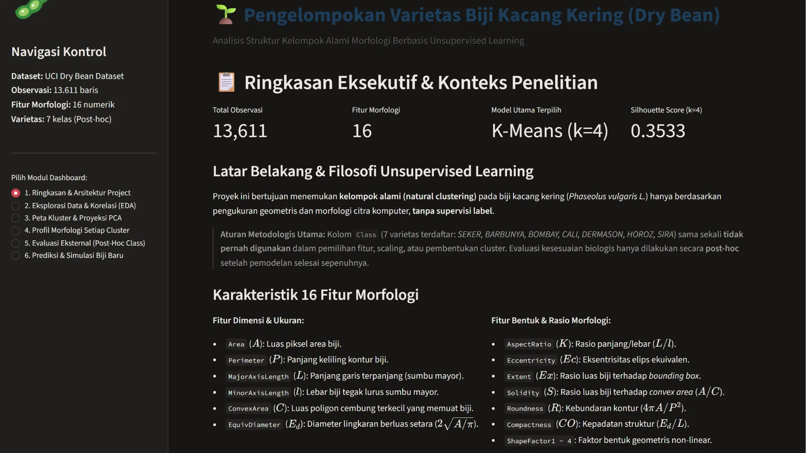
The executive overview module of the Streamlit dashboard summarizes the 13,611-specimen dataset, 16 geometric features, K-Means (`k = 4`) model selection, and the strict unsupervised methodology that isolates the `Class` label until post-hoc evaluation.

### 2. Streamlit EDA — Pearson Correlation & Multicollinearity View
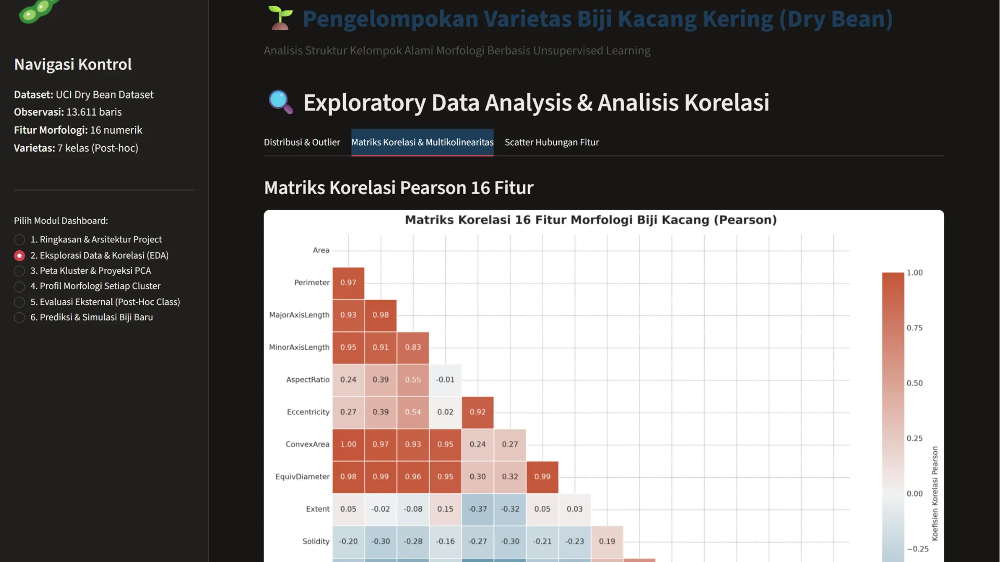
The interactive correlation sub-tab displays the lower-triangular Pearson correlation heatmap across all 16 morphological variables, highlighting near-unit multicollinearity among size descriptors (`Area`, `ConvexArea`, `EquivDiameter`, `Perimeter`).

### 3. Streamlit EDA — Interactive Feature Relationship Scatterplot
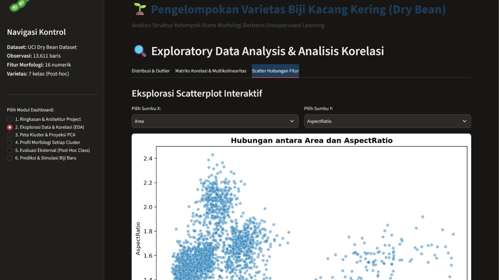
The interactive feature-pair explorer plots 2,500 sampled specimens across user-selected axes (`Area` vs. `AspectRatio`), revealing the distinct right-tail separation of giant specimens and continuous density clouds among medium-sized beans.

### 4. Streamlit Cluster Map & 2D PCA Projection Dashboard
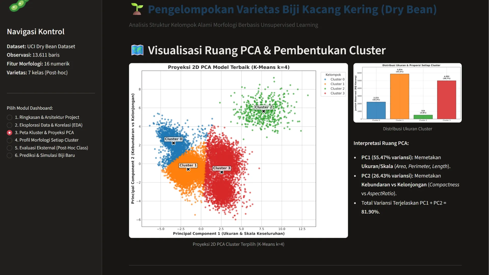
The cluster map tab pairs the 2D PCA projection of K-Means (`k = 4`) assignments and black centroid markers with the cluster size bar chart, showing that `PC1` (`55.47%`) and `PC2` (`26.43%`) together capture `81.90%` of morphological variance.

### 5. Streamlit Cluster Morphological Z-Score Profile View
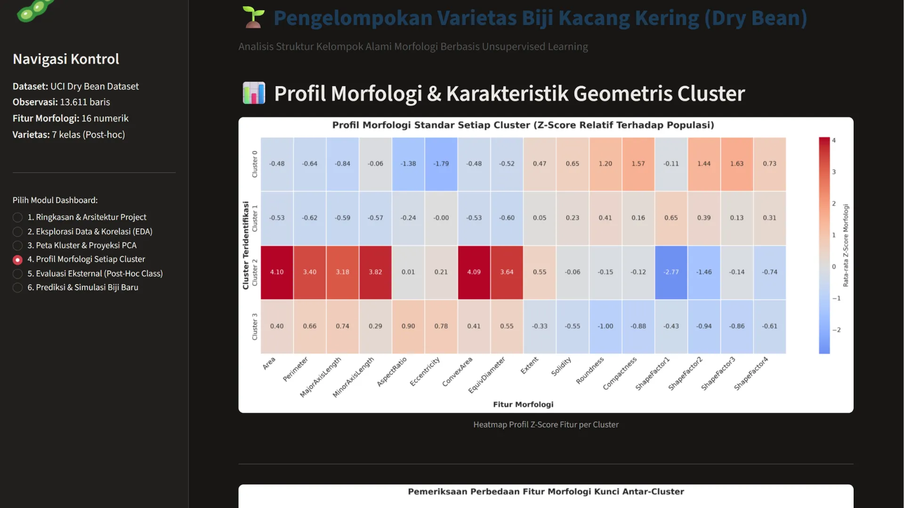
The morphological profile module renders a standardized Z-score heatmap across Clusters 0–3, visually contrasting Cluster 2's extreme positive size deviations (`+4.10` Area) against Cluster 0's high compactness (`+1.57`) and Cluster 3's elevated aspect ratio (`+0.90`).

### 6. Streamlit Post-Hoc External Validation View
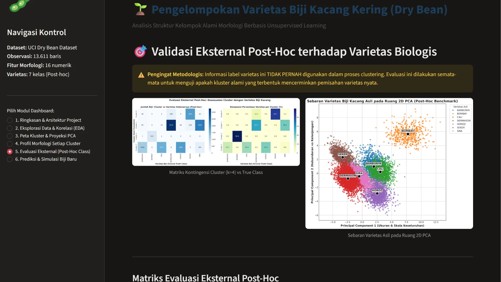
The post-hoc validation tab aligns the `k = 4` contingency matrix side-by-side with the ground-truth 7-variety 2D PCA scatter plot, confirming that geometric clusters correspond cleanly to `BOMBAY`, `SEKER`, and combined `DERMASON`/`SIRA` and `HOROZ`/`CALI`/`BARBUNYA` families.

### 7. Streamlit New Bean Prediction & Simulation Engine
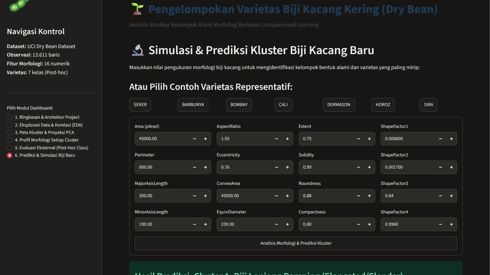
The inference simulator provides interactive numeric inputs for all 16 morphological measurements alongside quick-load preset buttons for each of the seven bean varieties to predict cluster membership and project new specimens onto the PCA map.

### 8. Morphological Feature Distributions (Histogram & KDE)
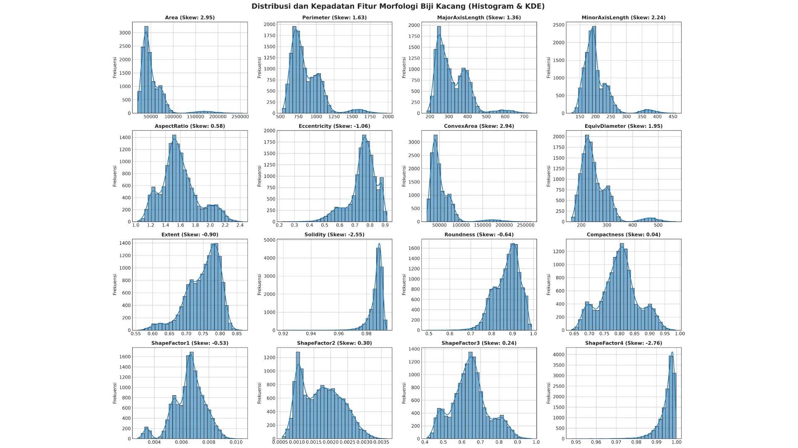
The 16-panel distribution grid reveals strong positive skewness in dimensional features (`Area` skew `+2.95`, `MinorAxisLength` skew `+2.24`) driven by giant `BOMBAY` specimens and negative skewness in contour regularity ratios (`Solidity` `-2.55`, `ShapeFactor4` `-2.76`).

### 9. Internal Metric Comparison & K-Means Elbow Analysis
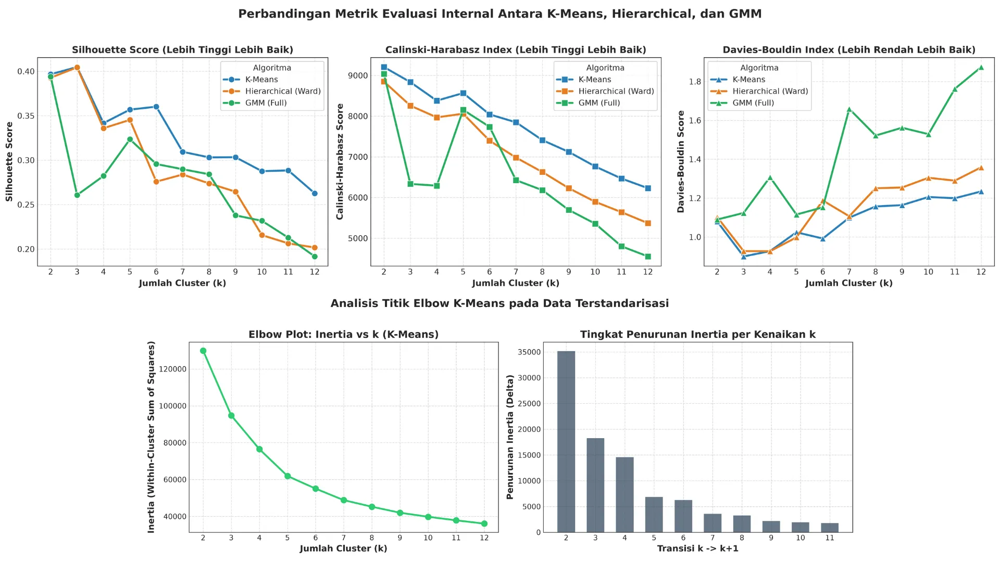
Multi-model comparison curves across `k = 2..12` demonstrate that K-Means consistently achieves higher Silhouette and Calinski-Harabasz scores and lower Davies-Bouldin scores than Hierarchical Ward and GMM (`full`), while the inertia delta bars show sharp drops through `k = 4`.

### 10. Standardized Feature Outliers & PCA Scree Plot
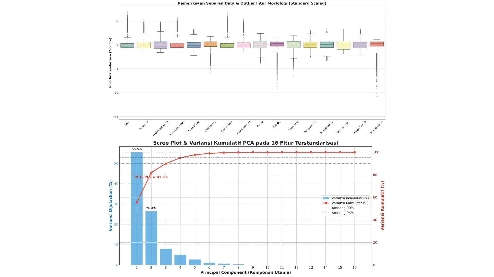
The standardized Z-score boxplots confirm extreme positive values above `+3 sigma` on `Area` and `ConvexArea` from legitimate giant beans, while the PCA scree plot verifies that four principal components exceed the `95%` cumulative variance threshold (`95.02%`).

### 11. Gaussian Mixture Model BIC & AIC Selection Curves
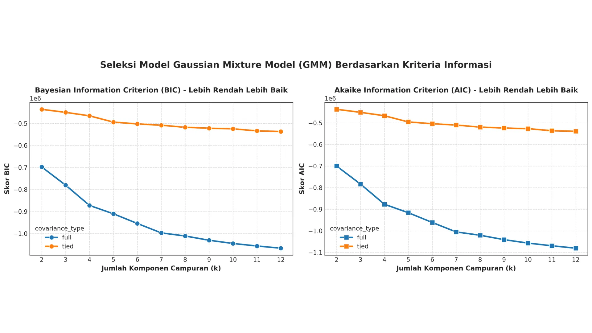
Information criterion curves across `k = 2..12` show that `full` covariance GMMs strongly outperform `tied` covariance models on both BIC and AIC, confirming that distinct morphological groups possess different covariance orientations.

### 12. Key Morphological Feature Boxplots Across Clusters
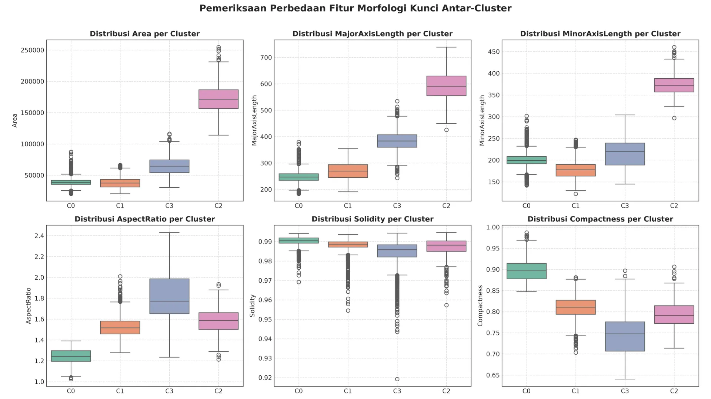
Six-panel boxplots of `Area`, `MajorAxisLength`, `MinorAxisLength`, `AspectRatio`, `Solidity`, and `Compactness` illustrate clear phenotypic differentiation across Clusters C0–C3, with C2 dominating scale features, C0 peaking in `Compactness`, and C3 peaking in `AspectRatio`.

### 13. Cluster Size Distribution & DBSCAN k-Distance Graph
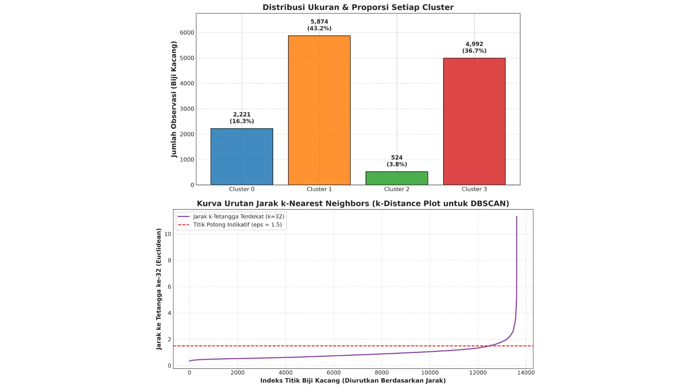
The primary `k = 4` size distribution exhibits balanced population coverage (`2,221`, `5,874`, `524`, and `4,992` specimens) without spurious micro-clusters, while the sorted `k = 32` nearest-neighbor distance curve explains why DBSCAN (`eps ~ 1.5`) suffers from density chaining across a continuous manifold.

### 14. Comparative K-Means (k = 7) vs. Ground-Truth Varieties on PCA
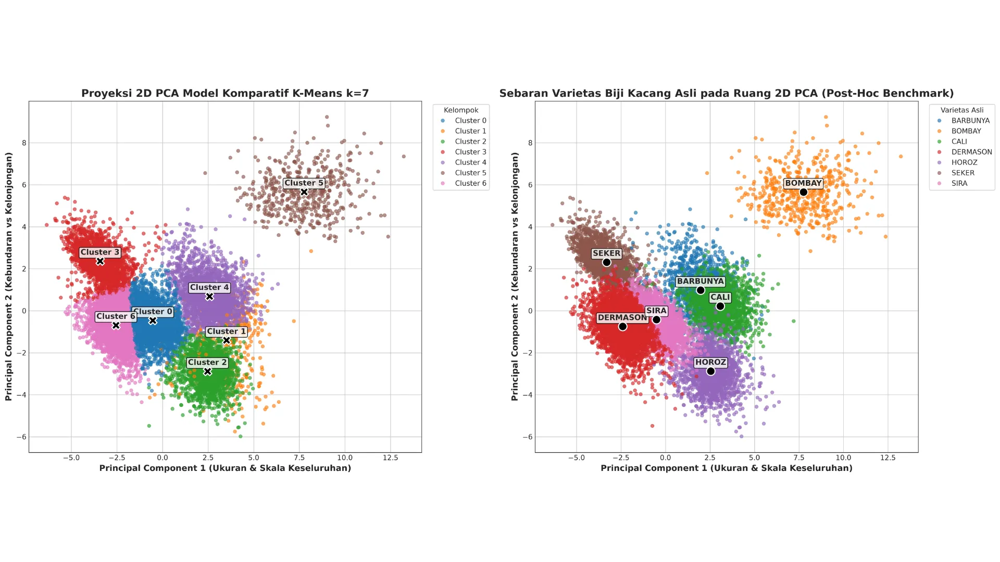
Side-by-side 2D PCA projections compare the comparative `k = 7` K-Means partition with the true seven-variety distribution, visually explaining how `BOMBAY`, `SEKER`, `DERMASON`, and `HOROZ` align cleanly while `BARBUNYA` and `CALI` share overlapping spatial coordinates.

### 15. Primary K-Means (k = 4) PCA Projection & Correlation Matrix
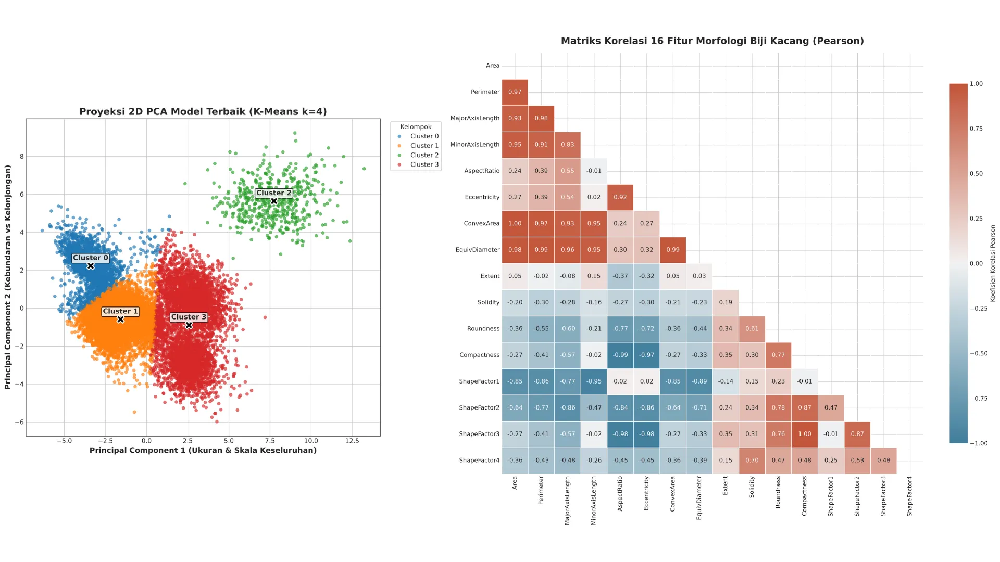
This composite overview pairs the four-cluster 2D PCA map (`k = 4`) with the full 16x16 Pearson correlation heatmap, linking feature-space redundancy directly to the orthogonal `PC1` (scale) and `PC2` (shape) axes.

### 16. Cluster Standardized Morphological Z-Score Heatmap
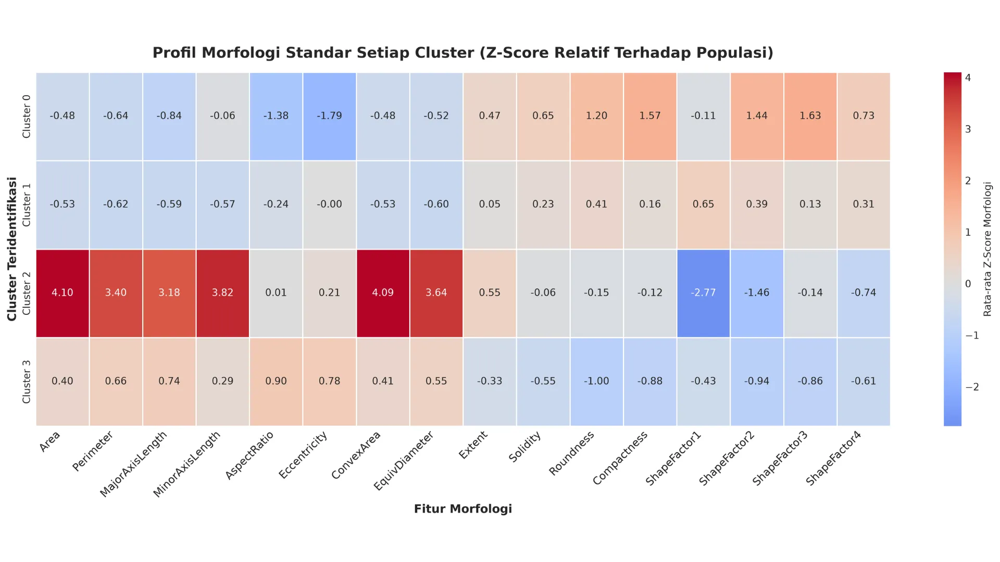
The standalone Z-score heatmap quantifies how each of the four K-Means clusters deviates from the overall population mean across all 16 shape descriptors, providing an interpretable phenotypic fingerprint for automated sorting rules.

### 17. Post-Hoc Contingency Heatmap — Primary Model (k = 4)
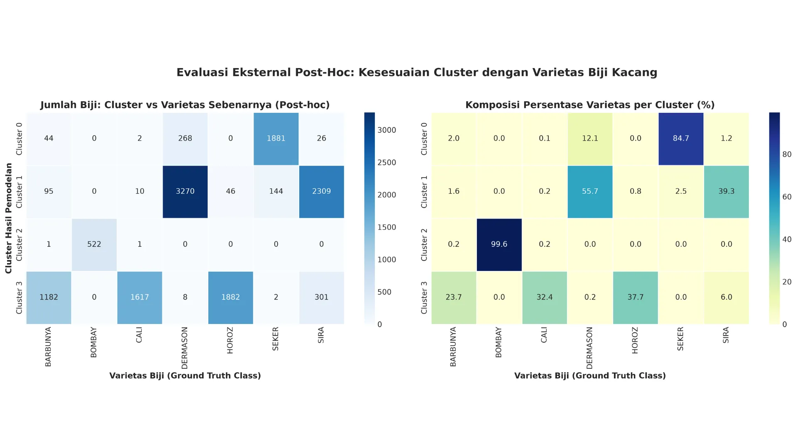
Raw specimen counts and row-normalized percentage compositions for `k = 4` verify `99.6%` `BOMBAY` purity in Cluster 2, `84.7%` `SEKER` purity in Cluster 0, `95.0%` combined `DERMASON`/`SIRA` in Cluster 1, and `93.8%` combined `HOROZ`/`CALI`/`BARBUNYA` in Cluster 3.

### 18. Post-Hoc Contingency Heatmap — Comparative Model (k = 7)
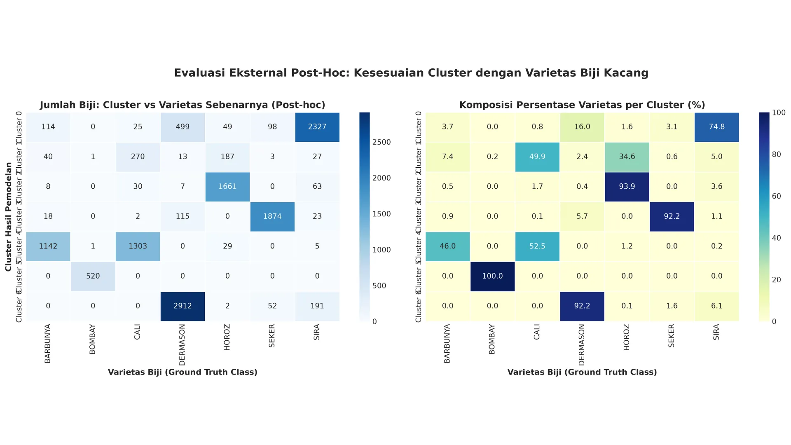
The `k = 7` contingency heatmap achieves `79.84%` overall purity (`ARI = 0.6688`, `NMI = 0.7139`), isolating `BOMBAY` (`100.0%`), `HOROZ` (`93.9%`), `DERMASON` (`92.2%`), and `SEKER` (`92.2%`) while revealing physical silhouette overlap between `CALI` (`52.5%`) and `BARBUNYA` (`46.0%`) in Cluster 4.

## Prerequisites

- Python `3.10` or higher (CPU execution is fully supported; no GPU or CUDA is required).
- `pip` package manager and virtual environment tooling (`venv`).
- Python dependencies listed in [requirements.txt](requirements.txt): `pandas>=2.2.0`, `numpy>=1.26.0`, `scikit-learn>=1.4.0`, `scipy>=1.12.0`, `matplotlib>=3.8.0`, `seaborn>=0.13.0`, `streamlit>=1.32.0`, `joblib>=1.3.0`, and `tabulate>=0.9.0`.
- Dataset file available at [dataset/original/Dry_Bean.csv](dataset/original/Dry_Bean.csv) (already included in this repository).

## Installation & Setup

1. Clone the repository and enter the project directory:
   ```bash
   git clone https://github.com/weztcy/Grouping-Dry-Bean-Varieties-Through-Shape-Based-Clustering.git
   cd "Grouping-Dry-Bean-Varieties-Through-Shape-Based-Clustering"
   ```

2. Create and activate a Python virtual environment:
   ```bash
   python -m venv .venv
   # Windows PowerShell
   .\.venv\Scripts\Activate.ps1
   # Linux / macOS
   source .venv/bin/activate
   ```

3. Install required Python packages:
   ```bash
   pip install -r requirements.txt
   ```

## Usage & Execution

Both [src/data_loader.py](src/data_loader.py) and [streamlit/app.py](streamlit/app.py) look for `Dry_Bean.csv` in the repository root or `dataset/Dry_Bean.csv` (while the repository stores the original file at [dataset/original/Dry_Bean.csv](dataset/original/Dry_Bean.csv)). Ensure `Dry_Bean.csv` is accessible at the root or `dataset/Dry_Bean.csv` before executing scripts that load it directly.

1. **Run the End-to-End Clustering Pipeline** (regenerates metrics, 16 plots in `figures/`, and serialized models in `models/`):
   ```bash
   python -m src.clustering_pipeline
   ```

2. **Launch the Interactive Streamlit Dashboard** (explores EDA, PCA cluster maps, morphological profiles, post-hoc validation, and new-specimen inference at `http://localhost:8501`):
   ```bash
   python -m streamlit run streamlit/app.py
   ```

3. **Explore or Rebuild the Jupyter Notebook**:
   Open [notebooks/clustering_workflow.ipynb](notebooks/clustering_workflow.ipynb) in JupyterLab or VS Code, or regenerate the notebook template via:
   ```bash
   python generate_notebook.py
   ```

## Reproducibility & Execution

All pipeline computations are seeded (`random_state=42`) across PCA, K-Means (`n_init=20`), GMM, and subsampling stability evaluations, with complete quantitative outputs archived in [models/pipeline_summary.json](models/pipeline_summary.json).

1. Use the exact dependency floor specified in [requirements.txt](requirements.txt) and ensure [dataset/original/Dry_Bean.csv](dataset/original/Dry_Bean.csv) (`13,611` rows, `17` columns) is placed at `Dry_Bean.csv` or `dataset/Dry_Bean.csv` for [src/data_loader.py](src/data_loader.py).
2. Run `python -m src.clustering_pipeline` from the repository root to reproduce `models/best_clustering_model.joblib`, `models/kmeans_k7_model.joblib`, `models/scaler.joblib`, `models/pca_model.joblib`, `models/pipeline_summary.json`, and all `16` figures in `figures/`.
3. Note that deterministic outputs depend on preserving `random_state=42` and the same `scikit-learn` major version (`>=1.4.0`), as minor clustering solver updates across library versions may slightly shift floating-point tie-breaks or cluster label IDs.

## Contributing

Contributions are welcome for extending morphological descriptors, testing alternative manifold or clustering algorithms, or enhancing interactive visualizations.

1. Fork the repository.
2. Create a branch for the change.
3. Make the changes.
4. Run relevant checks or tests when available (e.g., `python -m src.clustering_pipeline`).
5. Commit and push the branch.
6. Open a pull request with a clear explanation.

## License

This project is licensed under the MIT License.
See the [LICENSE](LICENSE) file for details.

## Author & Contact

**Yohanes Dimas Pratama**

- GitHub: [github.com/weztcy](https://github.com/weztcy)
- Portfolio: [yohanesdimas.com](https://yohanesdimas.com)
- LinkedIn: [linkedin.com/in/yohanes-dimas](https://www.linkedin.com/in/yohanes-dimas)
