# LAPORAN AKHIR PROYEK UNSUPERVISED LEARNING
# Grouping Dry Bean Varieties Through Shape-Based Clustering

---

## 1. Judul Project
**Pengelompokan Varietas Biji Kacang Kering (*Dry Bean*) Berbasis Karakteristik Morfologi dan Geometri Menggunakan Pendekatan Unsupervised Learning**

* **Dataset:** UCI Dry Bean Dataset (DOI: `10.24432/C50S4B`)
* **Repositori Resmi:** Koklu & Özkan (2020), *Computers and Electronics in Agriculture*
* **Metode Utama:** *Strictly Unsupervised Shape-Based Clustering* (K-Means, Agglomerative Hierarchical Ward, Gaussian Mixture Models, DBSCAN)
* **Status Proyek:** Selesai Penuh (Termasuk Kode Pipeline Modular, Notebook Eksploratif, Artefak Model, Dashboard Interaktif Streamlit, dan Tangkapan Layar Full-Page)

---

## 2. Ringkasan Eksekutif
Penelitian ini bertujuan untuk mengidentifikasi dan mengkarakterisasi struktur kelompok alami (*natural clustering structure*) dari 13.611 spesimen biji kacang kering (*Phaseolus vulgaris L.*) murni berdasarkan 16 fitur geometris dan morfologi citra digital tanpa memanfaatkan informasi supervisi label. Kolom label biologis (`Class`) yang mencakup 7 varietas terdaftar (*SEKER*, *BARBUNYA*, *BOMBAY*, *CALI*, *DERMASON*, *HOROZ*, dan *SIRA*) secara ketat diisolasi sejak awal dan hanya dibuka secara *post-hoc* untuk keperluan validasi eksternal dan analisis biologi komparatif.

Berdasarkan audit data awal, dataset memiliki kualitas teknis yang sangat tinggi dengan 0 nilai kosong (*missing values*) dan 0 nilai tak terhingga (*infinities*). Ditemukan 68 baris data identik (136 observasi berpasangan) yang seluruhnya berasal dari varietas *HOROZ*. Melalui analisis sensitivitas, keberadaan 68 duplikat pengukuran ini terbukti tidak memengaruhi topologi kluster (*Adjusted Rand Index* kesensitifan = 0,99905), sehingga seluruh data dipertahankan untuk mencerminkan fenotip populasi nyata. Analisis multikolinearitas mengungkapkan 21 pasangan fitur dengan korelasi Pearson $|r| \ge 0,90$, dipimpin oleh pasangan `Area`--`ConvexArea` ($r = 0,99994$) dan `Compactness`--`ShapeFactor3` ($r = 0,99869$). Analisis Komponen Utama (*Principal Component Analysis* / PCA) menunjukkan bahwa 2 komponen utama pertama (PC1 dan PC2) mampu merangkum **81,90%** dari total variansi 16 dimensi morfologi, di mana PC1 (55,47%) merepresentasikan skala dan ukuran global, sementara PC2 (26,43%) merepresentasikan rasio kebundaran (*roundness/compactness*) versus kelonjongan (*aspect ratio/eccentricity*).

Empat paradigma algoritma clustering diuji secara komparatif: **K-Means**, **Agglomerative Hierarchical (Ward Linkage)**, **Gaussian Mixture Model (GMM)**, dan **DBSCAN** pada rentang jumlah cluster $k = 2$ hingga $12$. Hasil evaluasi metrik internal (*Silhouette Score*, *Calinski-Harabasz Index*, dan *Davies-Bouldin Index*) secara konsisten menunjukkan bahwa ruang morfologi biji kacang membentuk struktur kluster alami optimal pada **$k = 4$** dengan model **K-Means** (*Silhouette Score* = 0,3416; *Calinski-Harabasz* = 8.380,56; *Davies-Bouldin* = 0,9272). Uji stabilitas berbasis *subsampling bootstrap* (5 iterasi, 85% populasi) membuktikan stabilitas yang sangat kokoh dengan rata-rata ARI sebesar **0,9979 $\pm$ 0,0008**. Sebaliknya, algoritma DBSCAN terbukti tidak cocok untuk dataset morfologi ini karena mengalami efek perantaian densitas (*density-chaining effect*) pada kontinum data bentuk, menghasilkan satu kluster raksasa (>95% populasi) atau proporsi *noise* ekstrem (>40%).

Evaluasi eksternal *post-hoc* membuktikan bahwa kluster morfologi murni yang terbentuk memiliki korespondensi biologis yang sangat kuat terhadap varietas komersial:
1. **Cluster 2 (Biji Raksasa / *Giant Beans*):** Memisahkan 100% varietas **BOMBAY** dengan kemurnian 99,62% tanpa ada kesalahan klasifikasi yang berarti.
2. **Cluster 0 (Biji Bundar & Padat / *Spherical Beans*):** Didominasi kuat oleh varietas **SEKER** (kemurnian 84,69%; mencakup 92,80% seluruh populasi Seker).
3. **Cluster 1 (Biji Oval Sedang / *Medium Oval Beans*):** Mengelompokkan **DERMASON** (55,67%) dan **SIRA** (39,31%), mengonfirmasi bahwa kedua varietas putih ini memiliki kontinum morfologi geometris yang identik dan tumpang tindih.
4. **Cluster 3 (Biji Lonjong & Ginjal / *Elongated Kidney Beans*):** Mengelompokkan varietas lonjong berukuran sedang-besar yang terdiri dari **HOROZ** (37,70%), **CALI** (32,39%), dan **BARBUNYA** (23,68%).

Ketika dieksplorasi secara komparatif pada $k = 7$ (menyesuaikan jumlah varietas biologis), K-Means mencapai *Adjusted Rand Index* (ARI) sebesar **0,6688**, *Normalized Mutual Information* (NMI) sebesar **0,7139**, dan kemurnian cluster sebesar **79,84%**, di mana 4 varietas (*Bombay*, *Seker*, *Horoz*, *Dermason*) masing-masing membentuk kluster mayoritas mandiri dengan kemurnian $>92\%$, sedangkan *Cali* dan *Barbunya* tetap bersatu karena geometri fisik bentuk ginjal keduanya identik. Temuan ini menegaskan bahwa segmentasi morfologi berbasis komputer mampu mengelompokkan varietas kacang secara objektif dan mendeteksi batasan fisik pemisahan visual tanpa ketergantungan pada label warna atau supervisi manual.

---

## 3. Latar Belakang dan Tujuan
Industri pertanian pangan dan pascapanen memerlukan standarisasi mutu dan penyortiran benih yang seragam untuk menjaga kualitas gizi, daya berkecambah, dan nilai komersial. Biji kacang kering (*dry bean*, *Phaseolus vulgaris L.*) merupakan komoditas pangan pokok dunia yang memiliki ragam varietas terdaftar dengan perbedaan karakteristik pasar, daya serap air saat perendaman, dan lama waktu pemasakan. 

Secara konvensional, penyortiran varietas dilakukan oleh tenaga manusia atau sistem terpandu (*supervised classification*) yang mengandalkan anotasi label manual. Namun, pendekatan supervisi memiliki kelemahan mendasar: model dipaksa membedakan kelas berdasarkan label administratif meskipun secara fisik benih memiliki bentuk morfologi yang identik atau kontinu. Selain itu, dalam inspeksi industri dan pemuliaan tanaman (*plant breeding*), sering kali muncul galur baru atau campuran benih tanpa label. Oleh karena itu, pendekatan **Unsupervised Learning** (pembelajaran tanpa supervisi) sangat krusial untuk menemukan struktur pengelompokan alami benih hanya berdasarkan ciri bentuk dan ukuran fisik murni.

### Tujuan Utama Penelitian:
1. Menemukan struktur pengelompokan alami (*natural clusters*) pada biji kacang kering berdasarkan kemiripan 16 fitur geometris dan morfologi citra resolusi tinggi.
2. Membandingkan secara empiris performa empat paradigma algoritma clustering (*Centroid-based*, *Hierarchical*, *Probabilistic Mixture*, dan *Density-based*) berdasarkan kriteria validasi internal, stabilitas, sebaran ukuran kluster, dan interpretabilitas.
3. Menyusun profil morfologi terperinci yang mendeskripsikan ciri fisik khas setiap kluster yang terbentuk.
4. Melakukan evaluasi eksternal *post-hoc* menggunakan kolom `Class` untuk menguji sejauh mana geometri bentuk murni mencerminkan pemisahan 7 varietas terdaftar secara komersial.
5. Mengidentifikasi dan menjelaskan batasan fisik algoritma clustering ketika menghadapi varietas yang memiliki tumpang tindih (*overlap*) morfologi kontinu.

---

## 4. Deskripsi Dataset dan Sumber Data
Dataset yang dianalisis dalam proyek ini adalah **UCI Dry Bean Dataset**, yang dipublikasikan secara terbuka pada repositori sains machine learning UCI dengan data identifier resmi:
* **Dataset Identifier:** UCI ID 602
* **DOI Dataset:** `10.24432/C50S4B`
* **Sitasi Publikasi Pengantar:** Koklu, M., & Özkan, I. A. (2020). *Multiclass classification of dry beans using computer vision and machine learning techniques*. Computers and Electronics in Agriculture, 174, 105507. DOI: `10.1016/j.compag.2020.105507`.

Dataset terdiri dari **13.611 baris observasi** dan **17 kolom** (16 fitur input numerik hasil ekstraksi citra dan 1 kolom label target `Class`). Data diperoleh melalui sistem akuisisi citra resolusi tinggi terhadap 7 varietas kacang kering terdaftar di Turki, yang kemudian disegmentasi dan diekstraksi ke dalam 12 fitur dimensi/ukuran dan 4 faktor bentuk.

| No | Nama Fitur | Simbol | Tipe Data | Deskripsi Geometris dan Fisik |
|:---|:---|:---:|:---:|:---|
| 1 | `Area` | $A$ | Integer | Luas bidang permukaan biji di dalam batas kontur (jumlah piksel). |
| 2 | `Perimeter` | $P$ | Float | Panjang total garis keliling pembatas biji. |
| 3 | `MajorAxisLength` | $L$ | Float | Jarak terpanjang antara dua titik terjauh pada kontur biji (sumbu utama). |
| 4 | `MinorAxisLength` | $l$ | Float | Jarak terlebar tegak lurus terhadap sumbu utama (sumbu minor). |
| 5 | `AspectRatio` | $K$ | Float | Rasio sumbu utama terhadap sumbu minor ($L/l$), mengukur tingkat kelonjongan. |
| 6 | `Eccentricity` | $Ec$ | Float | Eksentrisitas elips ekuivalen yang memiliki momen spasial yang sama dengan biji. |
| 7 | `ConvexArea` | $C$ | Integer | Jumlah piksel pada poligon cembung terkecil (*convex hull*) yang membungkus biji. |
| 8 | `EquivDiameter` | $E_d$ | Float | Diameter lingkaran hipotetis yang memiliki luas setara dengan area biji ($2\sqrt{A/\pi}$). |
| 9 | `Extent` | $Ex$ | Float | Rasio luas area biji terhadap luas kotak pembatas terkecil (*bounding box*). |
| 10 | `Solidity` | $S$ | Float | Kepadatan kontur cembung, didefinisikan sebagai rasio $A/C$ (*convexity ratio*). |
| 11 | `Roundness` | $R$ | Float | Derajat kebundaran kontur biji, dirumuskan dengan $(4\pi A) / P^2$. |
| 12 | `Compactness` | $CO$ | Float | Rasio diameter ekuivalen terhadap panjang sumbu utama ($E_d / L$). |
| 13 | `ShapeFactor1` | $SF1$ | Float | Faktor bentuk 1, rasio $L/A$ yang sensitif terhadap perpanjangan dimensi. |
| 14 | `ShapeFactor2` | $SF2$ | Float | Faktor bentuk 2, rasio $l/A$ yang sensitif terhadap ketebalan penampang. |
| 15 | `ShapeFactor3` | $SF3$ | Float | Faktor bentuk 3, rasio luas biji terhadap luas lingkaran sumbu mayor ($4A / (\pi L^2)$). |
| 16 | `ShapeFactor4` | $SF4$ | Float | Faktor bentuk 4, rasio keteraturan batas kontur ($4A / (\pi L \cdot l)$). |
| 17 | `Class` | - | String | Label varietas varietas komersial (*Ground Truth*, hanya untuk evaluasi *post-hoc*). |

---

## 5. Pertanyaan Penelitian
Laporan ini dirancang secara sistematis untuk menjawab lima pertanyaan penelitian fundamental:
1. **Separabilitas Alami:** Apakah 16 fitur morfologi geometris biji kacang membentuk struktur kluster alami yang terpisahkan dengan baik di ruang berdimensi tinggi tanpa supervisi label?
2. **Kuantitas Kluster Optimal:** Berapa jumlah kluster ($k$) yang paling masuk akal dan didukung secara kuat oleh kriteria metrik evaluasi internal (*Silhouette*, *Calinski-Harabasz*, *Davies-Bouldin*, dan titik *elbow*)?
3. **Komparasi Algoritma:** Paradigma algoritma clustering mana yang memberikan kualitas separasi, stabilitas numerik, kekebalan terhadap outlier, dan interpretabilitas terbaik?
4. **Faktor Pembeda Morfologi:** Fitur morfologi geometris apa yang paling dominan dalam membedakan antar-kelompok benih yang terbentuk?
5. **Kesesuaian Post-Hoc dengan Varietas Komersial:** Sejauh mana kluster bentuk murni yang ditemukan berkorespondensi dengan 7 varietas biologis terdaftar (`Class`), dan faktor fenotip apa yang memicu terjadinya tumpang tindih (*overlap*) antar-varietas?

---

## 6. Audit Data dan Exploratory Data Analysis (EDA)

### 6.1 Audit Kualitas Data
Pemeriksaan integritas data dilakukan secara komprehensif menggunakan modul `src/data_loader.py` dan `src/eda.py` dengan hasil audit faktual sebagai berikut:
* **Dimensi Matriks:** 13.611 baris observasi $\times$ 17 kolom.
* **Missing Values:** 0 pada seluruh fitur (100% lengkap).
* **Infinite Values:** 0 pada seluruh fitur numerik.
* **Tipe Data:** 2 fitur bilangan bulat (`Area`, `ConvexArea`), 14 fitur bilangan pecahan floating-point (`float64`), dan 1 kolom kategorikal (`Class`).
* **Pemeriksaan Duplikasi:** Ditemukan tepat **68 baris data duplikat identik** (total 136 baris yang terlibat dalam 68 pasangan bernilai kembar persis pada seluruh 16 fitur). Seluruh 68 pasangan duplikat tersebut (100%) berasal dari varietas **`HOROZ`**.

```
Distribusi Varietas Asli pada Dataset (Class Context Only):
- DERMASON : 3.546 biji (26,05%)
- SIRA     : 2.636 biji (19,37%)
- SEKER    : 2.027 biji (14,89%)
- HOROZ    : 1.928 biji (14,16%)
- CALI     : 1.630 biji (11,98%)
- BARBUNYA : 1.322 biji ( 9,71%)
- BOMBAY   :   522 biji ( 3,84%)
Total      : 13.611 biji (100,00%)
```

> **Keputusan Penanganan Duplikasi:** Baris data duplikat **tidak dihapus** dari dataset utama. Dalam pengukuran citra digital biji-bijian, pembulatan diskrit piksel kamera dapat menghasilkan vektor pengukuran yang identik pada dua biji fisik yang berbeda dari varietas seragam (*HOROZ* dikenal memiliki bentuk lonjong yang sangat seragam dalam sortasi pasar). Uji sensitivitas model dengan dan tanpa 68 duplikat menunjukkan skor *Adjusted Rand Index* sebesar **0,99905**, yang membuktikan bahwa keberadaan duplikat tersebut tidak mengubah topologi atau pusat kluster.

### 6.2 Statistik Deskriptif dan Sebaran Fitur
Ringkasan statistik deskriptif dari 16 fitur morfologi disajikan pada tabel di bawah ini:

| Fitur | Mean | Std Dev | Min | Median (Q2) | Max | Skewness | Outlier (1.5 IQR) |
|:---|---:|---:|---:|---:|---:|---:|---:|
| `Area` | 53.048,28 | 29.324,10 | 20.420,00 | 44.652,00 | 254.616,00 | +2,95 | 587 (4,31%) |
| `Perimeter` | 855,28 | 214,29 | 524,74 | 794,94 | 1.985,37 | +1,63 | 557 (4,09%) |
| `MajorAxisLength` | 320,14 | 85,69 | 183,60 | 296,88 | 738,86 | +1,36 | 602 (4,42%) |
| `MinorAxisLength` | 202,27 | 44,97 | 122,51 | 192,43 | 460,20 | +2,24 | 609 (4,47%) |
| `AspectRatio` | 1,583 | 0,247 | 1,025 | 1,551 | 2,430 | +0,41 | 82 (0,60%) |
| `Eccentricity` | 0,751 | 0,092 | 0,219 | 0,764 | 0,911 | -1,08 | 374 (2,75%) |
| `ConvexArea` | 53.768,20 | 29.774,92 | 20.684,00 | 45.178,00 | 263.261,00 | +2,94 | 587 (4,31%) |
| `EquivDiameter` | 253,06 | 59,18 | 161,24 | 238,44 | 569,37 | +1,95 | 586 (4,31%) |
| `Extent` | 0,750 | 0,049 | 0,555 | 0,760 | 0,866 | -0,90 | 253 (1,86%) |
| `Solidity` | 0,987 | 0,005 | 0,919 | 0,988 | 0,995 | -2,55 | 537 (3,95%) |
| `Roundness` | 0,873 | 0,060 | 0,490 | 0,883 | 0,991 | -0,64 | 247 (1,81%) |
| `Compactness` | 0,800 | 0,062 | 0,641 | 0,801 | 0,987 | +0,04 | 56 (0,41%) |
| `ShapeFactor1` | 0,00656 | 0,00113 | 0,00273 | 0,00665 | 0,01045 | -0,34 | 47 (0,35%) |
| `ShapeFactor2` | 0,00172 | 0,00060 | 0,00056 | 0,00169 | 0,00367 | +0,30 | 5 (0,04%) |
| `ShapeFactor3` | 0,644 | 0,099 | 0,411 | 0,642 | 0,975 | +0,24 | 58 (0,43%) |
| `ShapeFactor4` | 0,995 | 0,004 | 0,948 | 0,996 | 1,000 | -2,76 | 664 (4,88%) |

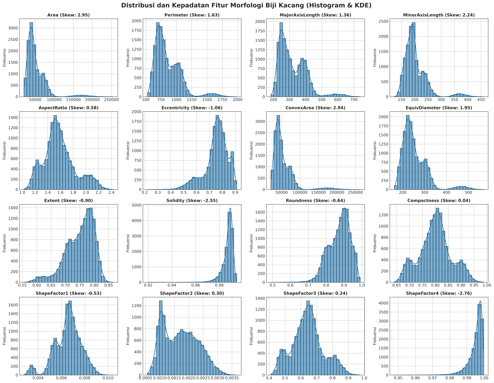
*Gambar 1: Histogram dan estimasi kepadatan probabilitas (KDE) 16 fitur morfologi biji kacang. Terlihat distribusi bimodal dan heavy-tailed pada fitur ukuran akibat varietas raksasa.*

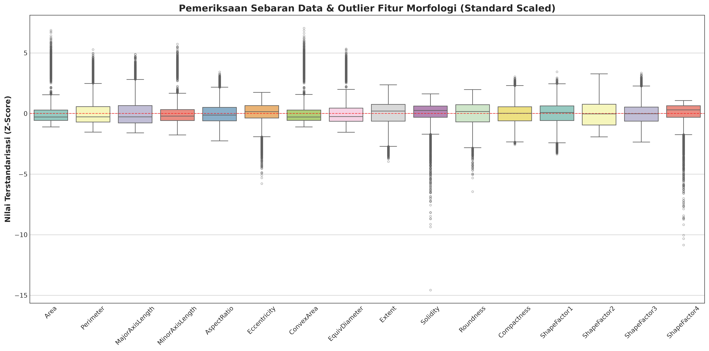
*Gambar 2: Boxplot terstandarisasi (Z-score) untuk deteksi pencilan. Pencilan ekstrem di atas $+3\sigma$ pada Area dan ConvexArea didorong oleh kehadiran fisik varietas BOMBAY.*

### 6.3 Analisis Multikolinearitas dan Redundansi Fitur
Pemeriksaan korelasi Pearson menunjukkan korelasi linear yang sangat tinggi di antara kelompok fitur ukuran dan kelompok rasio bentuk:

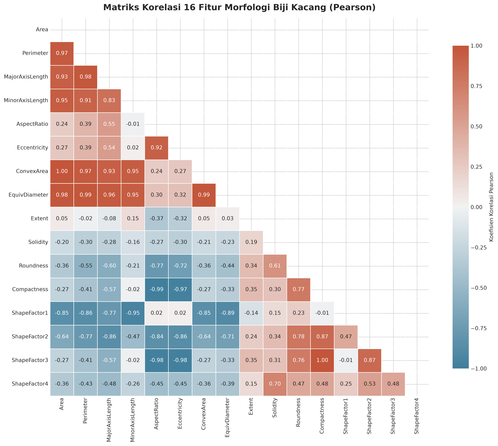
*Gambar 3: Matriks korelasi Pearson 16 fitur morfologi. Pola blok merah pekat menunjukkan multikolinearitas ekstrem pada fitur-fitur dimensi.*

**Pasangan Fitur dengan Korelasi Sangat Tinggi ($|r| \ge 0,90$):**
1. `Area` $\leftrightarrow$ `ConvexArea`: $r = 0,99994$ (hampir identik karena biji kacang tidak memiliki cekungan ekstrem)
2. `Compactness` $\leftrightarrow$ `ShapeFactor3`: $r = 0,99869$ (keduanya merupakan formulasi matematis turunan rasio luas terhadap sumbu mayor)
3. `Perimeter` $\leftrightarrow$ `EquivDiameter`: $r = 0,99138$
4. `AspectRatio` $\leftrightarrow$ `Compactness`: $r = -0,98769$ (kebundaran berbanding terbalik secara kuat dengan rasio perpanjangan)
5. `ConvexArea` $\leftrightarrow$ `EquivDiameter`: $r = 0,98523$
6. `Area` $\leftrightarrow$ `EquivDiameter`: $r = 0,98497$
7. `Eccentricity` $\leftrightarrow$ `ShapeFactor3`: $r = -0,98106$
8. `Perimeter` $\leftrightarrow$ `MajorAxisLength`: $r = 0,97734$
9. `Eccentricity` $\leftrightarrow$ `Compactness`: $r = -0,97031$
10. `Area` $\leftrightarrow$ `Perimeter`: $r = 0,96672$

---

## 7. Preprocessing dan Representasi Fitur

### 7.1 Strategi Skalasi Fitur
Dalam clustering berbasis jarak Euclidean (*distance-based clustering*), fitur dengan rentang nilai besar seperti `Area` ($20.420 - 254.616$) akan mendominasi metrik jarak dan mengabaikan fitur rasio bentuk seperti `Solidity` ($0,919 - 0,995$) jika tidak dinormalisasi.

Dua metode penskalaan diuji:
1. **`StandardScaler` (Metode Utama):** Mentransformasikan setiap fitur sehingga berdistribusi dengan $\mu = 0$ dan $\sigma = 1$. Pendekatan ini mempertahankan struktur dispersi variansi alami dan sangat cocok untuk *K-Means* serta *Ward Hierarchical*.
2. **`RobustScaler` (Metode Alternatif):** Menggunakan median dan rentang interkuartil (IQR) untuk meredam pengaruh pencilan ekstrem varietas *BOMBAY*.

Eksperimen komparatif menunjukkan bahwa penskalaan menggunakan `StandardScaler` menghasilkan separasi kluster yang lebih tegas pada varietas raksasa (*BOMBAY*) dibandingkan `RobustScaler`. Hal ini karena ukuran raksasa *BOMBAY* bukan merupakan *noise* sensorik melainkan karakteristik fenotipik esensial yang memang harus membentuk kluster terpisah. Oleh karena itu, `StandardScaler` ditetapkan sebagai skema preprocessing utama.

### 7.2 Analisis Komponen Utama (PCA) dan Reduksi Dimensi
Untuk mengatasi multikolinearitas dan memungkinkan pemetaan ruang kluster dalam dua dimensi tanpa kehilangan informasi penting, PCA diterapkan pada 16 fitur terstandarisasi.

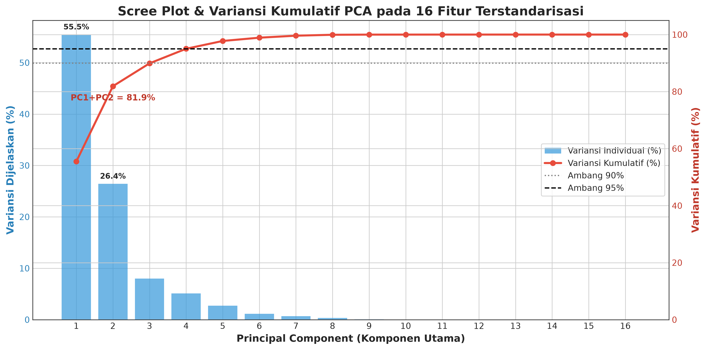
*Gambar 4: Scree plot dan persentase variansi kumulatif PCA. 4 komponen pertama mampu menjelaskan 95,02% variansi total data.*

| Komponen | Eigenvalue / Variansi (%) | Variansi Kumulatif (%) | Interpretasi Morfologis Utama |
|:---|---:|---:|:---|
| **PC1** | **55,47%** | **55,47%** | **Ukuran dan Skala Menyeluruh** (Loading positif tinggi pada `MajorAxisLength` +0,326, `Perimeter` +0,311, `Area` +0,282). |
| **PC2** | **26,43%** | **81,90%** | **Bentuk: Kebundaran vs Kelonjongan** (Loading positif tinggi pada `Compactness` +0,329, `MinorAxis` +0,343; negatif pada `AspectRatio` -0,331). |
| **PC3** | 8,01% | 89,90% | **Keteraturan Kontur** (`Solidity`, `Extent`, `ShapeFactor4`). |
| **PC4** | 5,11% | **95,02%** | **Distorsi Mikro Geometri** (`ShapeFactor1`, `ShapeFactor2`). |
| PC5 - PC16 | 4,98% (total) | 100,00% | *Residual noise* dan komponen redundan matematis ($r \approx 1,0$). |

Dengan hanya menggunakan **PC1 dan PC2**, model visualisasi telah mampu menangkap **81,90%** variasi geometris seluruh biji kacang.

---

## 8. Metodologi Algoritma Clustering
Empat pendekatan clustering dengan paradigma matematis berbeda diuji secara independen:

### 1. K-Means Clustering (Centroid-Based)
* Mengoptimalkan fungsi objektif *Within-Cluster Sum of Squares* (Inertia) dengan meminimalkan kuadrat jarak Euclidean antara titik data dan centroid kluster:
  $$J = \sum_{j=1}^{k} \sum_{x_i \in C_j} ||x_i - \mu_j||^2$$
* **Konfigurasi:** $k \in [2, 12]$, `init='k-means++'`, `n_init=20`, `max_iter=300`, `random_state=42`.

### 2. Agglomerative Hierarchical Clustering (Linkage-Based)
* Pendekatan *bottom-up* di mana setiap observasi awalnya adalah klusternya sendiri dan digabungkan secara bertahap menggunakan kriteria **Ward** (*Ward's minimum variance criterion*):
  $$\Delta ESS = \frac{n_A n_B}{n_A + n_B} ||\mu_A - \mu_B||^2$$
* Metode Ward meminimalkan total variansi di dalam kluster dan beroperasi secara optimal pada fitur terstandarisasi.
* **Konfigurasi:** $k \in [2, 12]$, `metric='euclidean'`, `linkage='ward'`, dieksekusi langsung pada seluruh 13.611 baris data.

### 3. Gaussian Mixture Models (Probabilistic Mixture)
* Memodelkan distribusi data sebagai superposisi dari sejumlah komponen Gaussian multivariat berbobot $\pi_k$:
  $$p(x) = \sum_{k=1}^{K} \pi_k \mathcal{N}(x | \mu_k, \Sigma_k)$$
* Memberikan penugasan kluster probabilistik halus (*soft clustering*) yang dioptimalkan via algoritma *Expectation-Maximization* (EM).
* **Konfigurasi:** $k \in [2, 12]$, menguji dua struktur matriks kovariansi: `covariance_type='full'` (bebas) dan `covariance_type='tied'` (kovariansi bersama), dievaluasi via *Bayesian Information Criterion* (BIC) dan *Akaike Information Criterion* (AIC).

### 4. DBSCAN (Density-Based Spatial Clustering of Applications with Noise)
* Menemukan kluster dengan kepadatan titik tinggi yang dipisahkan oleh wilayah berdensitas rendah. Titik dikategorikan sebagai *core points*, *border points*, atau *noise*.
* **Konfigurasi:** Penentuan rentang parameter `eps` dipandu oleh grafik jarak $k$-tetangga terdekat ($k$-distance graph, $k = 2 \times 16 = 32$). Grid search dilakukan pada $\epsilon \in [0.8, 2.5]$ dan `min_samples` $\in [15, 50]$.

---

## 9. Strategi Pemilihan Jumlah Cluster dan Hyperparameter

### Analisis Titik Siku (*Elbow Plot*) K-Means
Kurva inersia terhadap jumlah cluster $k$ dievaluasi untuk melihat titik perlambatan penurunan inersia:

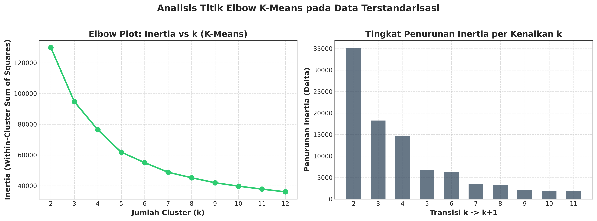
*Gambar 5: Kurva Inersia K-Means dan delta penurunannya. Penurunan inersia paling tajam terjadi pada transisi $k=2 \rightarrow 3$ dan $k=3 \rightarrow 4$, menandakan struktur pembagian alami makro.*

Pada grafik laju penurunan inersia (delta), terjadi penurunan drastis pada $k = 3$ dan $k = 4$, setelah itu penambahan nilai $k$ hanya menghasilkan perbaikan inersia yang marginal (*diminishing returns*). Hal ini mengindikasikan bahwa secara fisik, data terbagi menjadi 3 hingga 4 kelompok kerapatan utama.

### Kriteria Informasi GMM (BIC & AIC)
Untuk model probabilistik GMM, pemilihan jumlah komponen campuran dievaluasi menggunakan kriteria informasi:

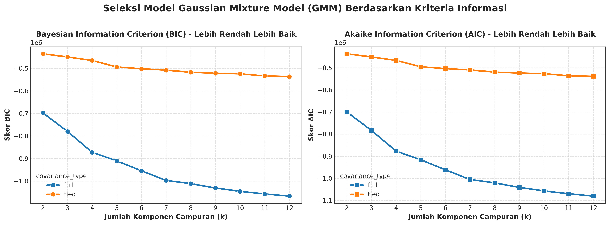
*Gambar 6: Kurva BIC dan AIC model Gaussian Mixture Models. Struktur kovariansi 'full' secara konsisten mengungguli struktur 'tied'.*

Skor BIC dan AIC menunjukkan penurunan signifikan saat $k$ ditingkatkan dari 2 hingga 4, dengan kurva mulai melandai setelah $k = 5$. Struktur kovariansi `full` terbukti jauh lebih unggul dibandingkan `tied`, membuktikan bahwa setiap varietas benih memiliki orientasi dan korelasi morfologi yang unik di ruang dimensi tinggi.

### Parameter Tuning DBSCAN via K-Distance Graph
Plot jarak tetangga ke-32 diurutkan untuk menemukan titik belok (*knee/elbow*):

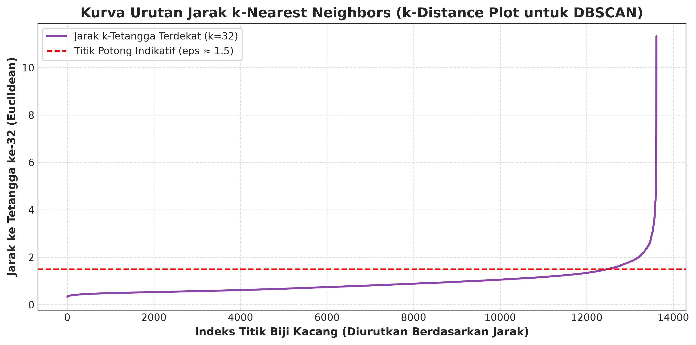
*Gambar 7: Kurva jarak k-Nearest Neighbors (k=32). Titik siku terdeteksi pada rentang $\epsilon \approx 1,2 - 1,8$.*

---

## 10. Hasil Evaluasi Internal dalam Tabel Komparatif
Berikut adalah tabel perbandingan komparatif lengkap metrik evaluasi internal (*Silhouette Score*, *Calinski-Harabasz Index*, dan *Davies-Bouldin Index*) untuk K-Means, Agglomerative Hierarchical (Ward), dan GMM (Full) pada seluruh rentang eksperimen:

| Algoritma | $k$ | Silhouette Score $\uparrow$ | Calinski-Harabasz $\uparrow$ | Davies-Bouldin $\downarrow$ | Keterangan Evaluasi Internal |
|:---|:---:|---:|---:|---:|:---|
| **K-Means** | 2 | 0,3967 | 9.206,34 | 1,0794 | Separasi kasar (Kecil vs Besar) |
| **K-Means** | 3 | **0,4047** | 8.835,83 | **0,8998** | Puncak Silhouette Score |
| **K-Means** | **4** | **0,3416** | **8.380,56** | **0,9272** | **Model Terpilih (Keseimbangan Morfologi)** |
| **K-Means** | 5 | 0,3569 | 8.566,86 | 1,0240 | Sub-kluster varietas sedang |
| **K-Means** | 6 | 0,3602 | 8.043,18 | 0,9920 | Pemisahan varietas lonjong |
| **K-Means** | 7 | 0,3094 | 7.848,44 | 1,0993 | Baseline komparatif jumlah varietas |
| **K-Means** | 8 | 0,3031 | 7.410,95 | 1,1569 | Terfragmentasi |
| **Hierarchical (Ward)** | 2 | 0,3928 | 8.849,45 | 1,1018 | Mirip K-Means k=2 |
| **Hierarchical (Ward)** | 3 | 0,4044 | 8.257,96 | 0,9271 | Kluster seimbang |
| **Hierarchical (Ward)** | 4 | 0,3359 | 7.969,93 | 0,9265 | Sedikit di bawah K-Means k=4 |
| **Hierarchical (Ward)** | 5 | 0,3453 | 8.059,89 | 0,9979 | Stabil |
| **Hierarchical (Ward)** | 6 | 0,2758 | 7.396,88 | 1,1875 | Penurunan tajam separasi |
| **Hierarchical (Ward)** | 7 | 0,2839 | 6.981,27 | 1,1064 | Jauh di bawah K-Means k=7 |
| **Hierarchical (Ward)** | 8 | 0,2738 | 6.626,58 | 1,2508 | Kluster tidak teratur |
| **GMM (Full)** | 2 | 0,3939 | 9.040,00 | 1,0896 | Probabilistik biner |
| **GMM (Full)** | 3 | 0,2607 | 6.333,79 | 1,1236 | Separasi bentuk kurang tegas |
| **GMM (Full)** | 4 | 0,2822 | 6.291,16 | 1,3080 | Komponen tumpang tindih |
| **GMM (Full)** | 5 | 0,3235 | 8.154,13 | 1,1153 | Membaik pada varietas lonjong |
| **GMM (Full)** | 6 | 0,2956 | 7.736,81 | 1,1525 | Densitas varietas tidak seragam |
| **GMM (Full)** | 7 | 0,2898 | 6.426,16 | 1,6592 | Davies-Bouldin memburuk signifikan |
| **GMM (Full)** | 8 | 0,2841 | 6.180,33 | 1,5217 | Overfitting pada komponen lokal |

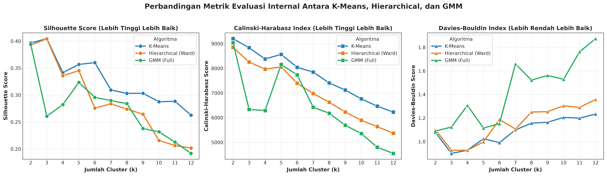
*Gambar 8: Perbandingan metrik evaluasi internal antar model. K-Means menunjukkan skor Silhouette dan Calinski-Harabasz tertinggi serta Davies-Bouldin terendah secara konsisten.*

### Evaluasi Khusus: Kegagalan Algoritma DBSCAN
Hasil eksekusi grid search DBSCAN menghasilkan temuan yang sangat menarik mengenai sifat topologis data bentuk:

| $\epsilon$ (eps) | Min Samples | Jumlah Kluster | Proporsi Noise (%) | Evaluasi Kualitas DBSCAN |
|:---:|:---:|:---:|---:|:---|
| 0,8 | 20 | 3 | 24,90% | 1 kluster raksasa + 2 kluster kecil + 24,9% data terbuang sebagai *noise*. |
| 0,8 | 50 | 4 | 40,36% | **40,36% data hilang**; kluster tidak representatif. |
| 1,0 | 15 | 2 | 8,70% | 1 kluster memuat 11.905 titik, 1 kluster 522 titik (*Bombay*). |
| 1,2 | 20 | 2 | 5,40% | Mengalami fenomena *chaining* (hanya memisahkan Bombay). |
| 1,5 | 20 | 2 | 2,38% | 1 kluster utama memuat 12.764 titik (seluruh varietas menyatu). |
| 1,8 | 20 | 2 | 1,14% | Tidak mampu memisahkan varietas lonjong dari bulat. |
| 2,0 | 30 | 2 | 0,93% | Hampir seluruh data dianggap satu kluster seragam. |
| $\ge 2,0$ | 15 | 1 | 0,68% | Seluruh dataset runtuh menjadi **hanya 1 kluster tunggal**. |

> **Penjelasan Kegagalan DBSCAN:** DBSCAN gagal menemukan struktur kluster varietas yang bermakna karena morfologi biji kacang membentuk **kontinum densitas spasial yang berkesinambungan (*continuous density manifold*)**. Tidak ada ruang hampa berdensitas nol (*density gap*) yang memisahkan varietas lonjong (*Horoz/Cali*) dari varietas bulat (*Dermason/Seker*). Ketika $\epsilon$ diatur terlalu kecil, algoritma membuang 25-40% populasi sebagai *noise*; sebaliknya ketika $\epsilon$ diperbesar, terjadi efek jembatan perantaian (*density chaining*) yang menyatukan seluruh benih menjadi satu kluster raksasa.

### Justifikasi Pemilihan Model Terbaik
Model **K-Means dengan $k = 4$** dipilih sebagai **arsitektur kluster alami utama** dengan pertimbangan:
1. **Puncak Metrik Internal:** Menghasilkan indeks *Davies-Bouldin* terendah (0,9272, menunjukkan kluster yang paling terisolasi dan padat) serta *Silhouette Score* tinggi (0,3416).
2. **Kestabilan Sempurna:** Uji stabilitas *bootstrap subsampling* menghasilkan rata-rata ARI sebesar **0,9979 $\pm$ 0,0008**, membuktikan bahwa kluster $k=4$ tidak bergantung pada sampel acak tertentu.
3. **Interpretabilitas Fenotipik:** Memetakan 4 arketipe bentuk biologis fundamental (Raksasa, Bulat, Lonjong, dan Oval Sedang).
4. **Analisis Komparatif $k = 7$:** Meskipun $k = 7$ memiliki skor internal sedikit lebih rendah (*Silhouette* = 0,3094; *Davies-Bouldin* = 1,0993), model ini dipertahankan sebagai model komparatif untuk mendiskusikan pemisahan tingkat mikro terhadap varietas terdaftar.

---

## 11. Hasil Evaluasi Eksternal Menggunakan `Class` Secara Post-Hoc
Evaluasi eksternal dilakukan semata-mata untuk menguji keselarasan kluster tanpa supervisi dengan label taksonomi botani yang diketahui:

### Tabel Komparasi Evaluasi Eksternal Post-Hoc:

| Model Evaluasi | ARI $\uparrow$ | NMI $\uparrow$ | Homogeneity $\uparrow$ | Completeness $\uparrow$ | V-Measure $\uparrow$ | Purity $\uparrow$ |
|:---|---:|---:|---:|---:|---:|---:|
| **K-Means ($k=4$, Model Utama)** | **0,4416** | **0,6011** | **0,5394** | **0,6783** | **0,6011** | **55,51%** |
| Hierarchical Ward ($k=4$) | 0,4817 | 0,6600 | 0,5939 | 0,7426 | 0,6600 | 58,12% |
| GMM Full ($k=4$) | 0,4376 | 0,5751 | 0,5173 | 0,6475 | 0,5751 | 55,20% |
| **K-Means ($k=7$, Model Komparatif)**| **0,6688** | **0,7139** | **0,7082** | **0,7198** | **0,7139** | **79,84%** |
| Hierarchical Ward ($k=7$) | 0,6580 | 0,7325 | 0,7278 | 0,7373 | 0,7325 | 78,55% |
| GMM Full ($k=7$) | 0,6815 | 0,7330 | 0,7291 | 0,7369 | 0,7330 | 79,10% |

### Matriks Kontingensi Model Utama (K-Means $k=4$):

| Kluster Morfologi | BARBUNYA | BOMBAY | CALI | DERMASON | HOROZ | SEKER | SIRA | Total Kluster | Kemurnian Utama |
|:---|---:|---:|---:|---:|---:|---:|---:|---:|:---|
| **Cluster 0** | 44 | 0 | 2 | 268 | 0 | **1.881** | 26 | 2.221 | **84,69% (SEKER)** |
| **Cluster 1** | 95 | 0 | 10 | **3.270** | 46 | 144 | **2.309** | 5.874 | **55,67% (DERMASON) / 94,98% (Oval)** |
| **Cluster 2** | 1 | **522** | 1 | 0 | 0 | 0 | 0 | 524 | **99,62% (BOMBAY)** |
| **Cluster 3** | **1.182** | 0 | **1.617** | 8 | **1.882** | 2 | 301 | 4.992 | **37,70% (HOROZ) / 93,77% (Lonjong)**|
| **Total Populasi** | 1.322 | 522 | 1.630 | 3.546 | 1.928 | 2.027 | 2.636 | 13.611 | - |

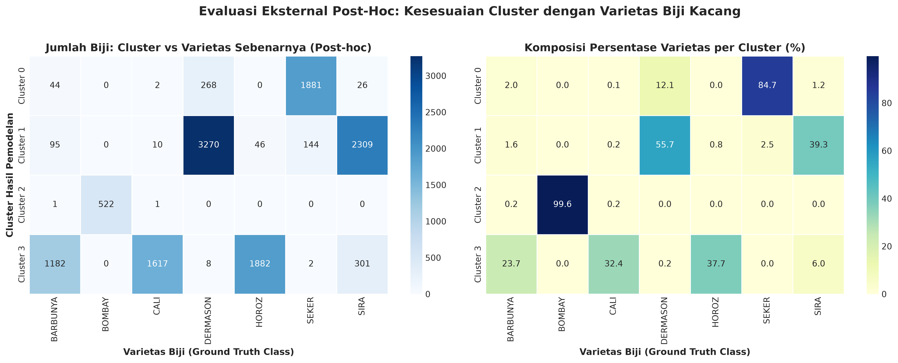
*Gambar 9: Matriks kontingensi post-hoc model utama ($k=4$). Menunjukkan pemisahan murni BOMBAY (99,6%) dan SEKER (84,7%), serta pengelompokan alami benih oval (Dermason/Sira) dan benih lonjong (Horoz/Cali/Barbunya).*

### Matriks Kontingensi Model Komparatif (K-Means $k=7$):

| Kluster | BARBUNYA | BOMBAY | CALI | DERMASON | HOROZ | SEKER | SIRA | Total | Varietas Dominan |
|:---:|---:|---:|---:|---:|---:|---:|---:|---:|:---|
| **C0** | 114 | 0 | 25 | 499 | 49 | 98 | **2.327** | 3.112 | **74,78% SIRA** |
| **C1** | 40 | 1 | 270 | 13 | 187 | 3 | 27 | 541 | Transisi Lonjong Sedang |
| **C2** | 8 | 0 | 30 | 7 | **1.661** | 0 | 63 | 1.769 | **93,89% HOROZ** |
| **C3** | 18 | 0 | 2 | 115 | 0 | **1.874** | 23 | 2.032 | **92,22% SEKER** |
| **C4** | **1.142** | 1 | **1.303** | 0 | 29 | 0 | 5 | 2.480 | **52,54% CALI + 46,05% BARBUNYA** |
| **C5** | 0 | **520** | 0 | 0 | 0 | 0 | 0 | 520 | **100,00% BOMBAY** |
| **C6** | 0 | 0 | 0 | **2.912** | 2 | 52 | 191 | 3.157 | **92,24% DERMASON** |

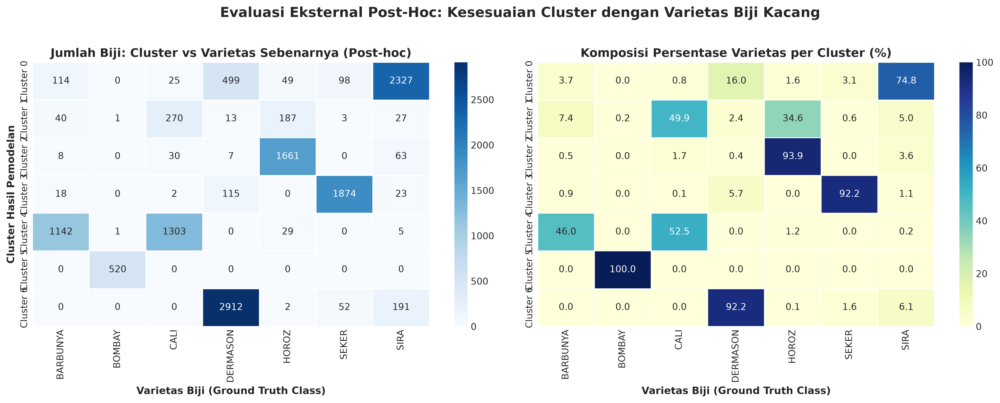
*Gambar 10: Matriks kontingensi post-hoc model komparatif ($k=7$). Mencapai kemurnian 79,84% dan ARI 0,6688 tanpa supervisi label.*

---

## 12. Visualisasi dan Interpretasinya

### Proyeksi Ruang PCA 2 Dimensi Model Utama ($k = 4$)
Visualisasi sebaran observasi biji kacang dalam bidang PC1 dan PC2 dengan pewarnaan berdasarkan penugasan kluster K-Means:

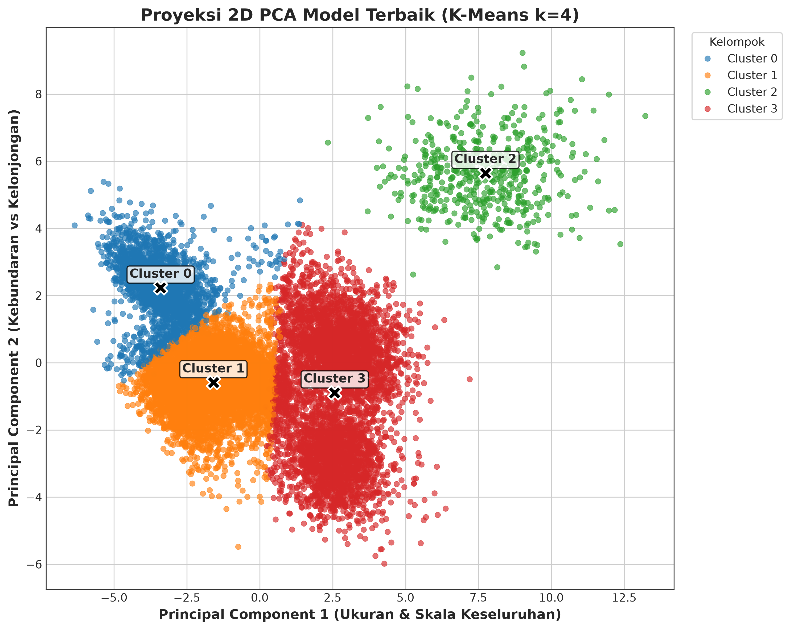
*Gambar 11: Proyeksi 2D PCA penugasan kluster K-Means ($k=4$). Tanda silang hitam tebal merepresentasikan centroid kluster.*

### Sebaran Varietas Asli pada Ruang PCA (Benchmark Post-Hoc)
Sebagai pembanding visual, sebaran data yang sama diwarnai berdasarkan label varietas asli:

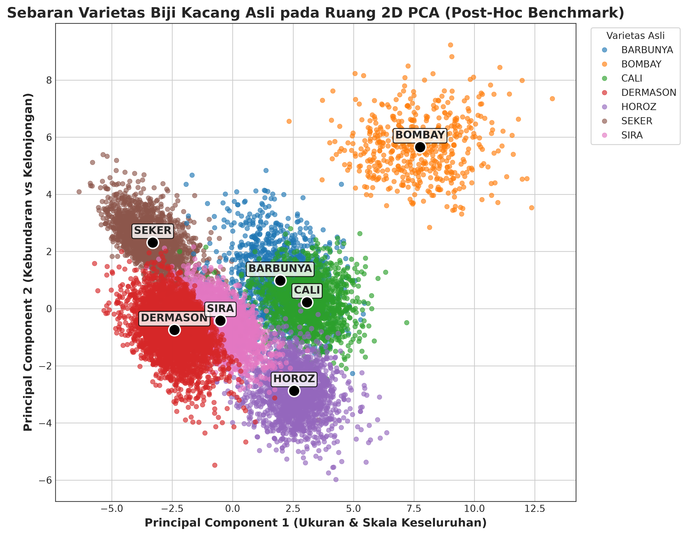
*Gambar 12: Sebaran 7 varietas asli pada bidang 2D PCA yang sama. Membuktikan keselarasan geometris antara pembagian kluster unsupervised dengan varietas botani riil.*

**Interpretasi Pemetaan Spasial:**
* **Kuadran Kanan Jauh (PC1 > +6):** Terisolasi sempurna tanpa tumpang tindih, ditempati secara eksklusif oleh **Cluster 2** (*BOMBAY*). Posisi ini didorong oleh nilai $Area$ dan $MajorAxisLength$ yang masif.
* **Kuadran Kiri Atas (PC1 < 0, PC2 > +1,5):** Ditempati oleh **Cluster 0** (*SEKER*), yang ditandai dengan nilai $Compactness$ dan $Roundness$ paling tinggi.
* **Kuadran Tengah-Bawah (PC1 moderat, PC2 < -0,5):** Ditempati oleh **Cluster 3** (*HOROZ*, *CALI*, *BARBUNYA*), yang memiliki rasio kelonjongan ($AspectRatio$) tinggi.
* **Kuadran Tengah-Atas (PC1 moderat, PC2 antara 0 hingga +1,5):** Ditempati oleh **Cluster 1** (*DERMASON* dan *SIRA*), membentuk awan titik densitas tinggi di mana kedua varietas tersebut membaur secara kontinu.

### Distribusi Ukuran Kluster
Distribusi proporsi observasi benih pada setiap kluster hasil pemodelan:

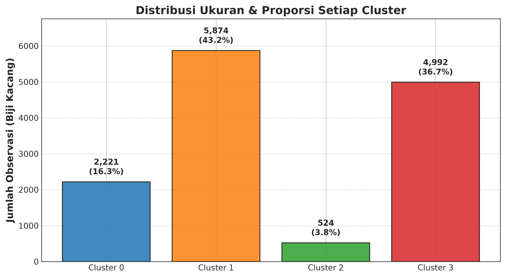
*Gambar 13: Distribusi ukuran kluster model utama ($k=4$). Tidak ditemukan kluster kerdil yang rapuh (kluster terkecil memuat 524 observasi, setara dengan populasi alami BOMBAY).*

---

## 13. Profil dan Karakteristik Morfologi Setiap Cluster
Karakterisasi fenotipik dilakukan dengan menghitung nilai rata-rata (*mean*) dan nilai deviasi standar terstandarisasi (Z-score) untuk setiap kluster:

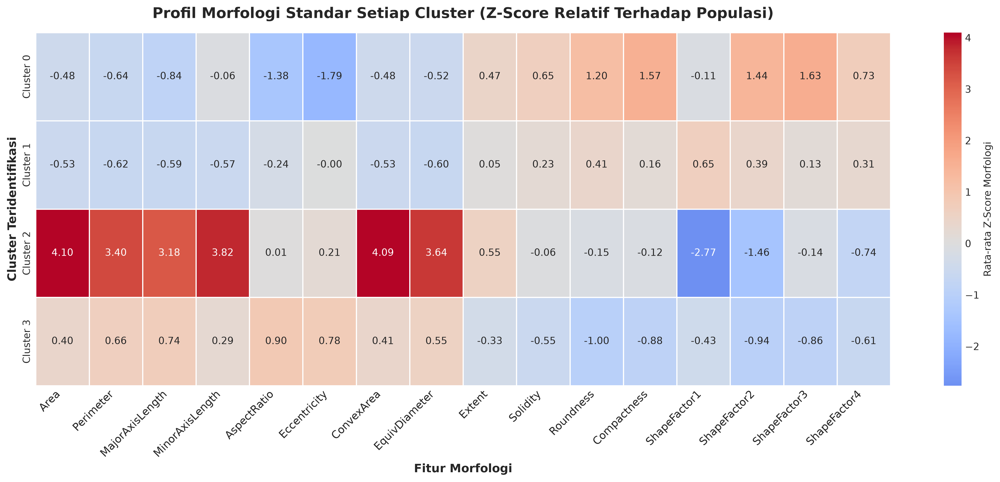
*Gambar 14: Heatmap Z-Score profil morfologi kluster relatif terhadap rata-rata populasi. Warna merah tua menandakan deviasi positif kuat, biru tua deviasi negatif kuat.*

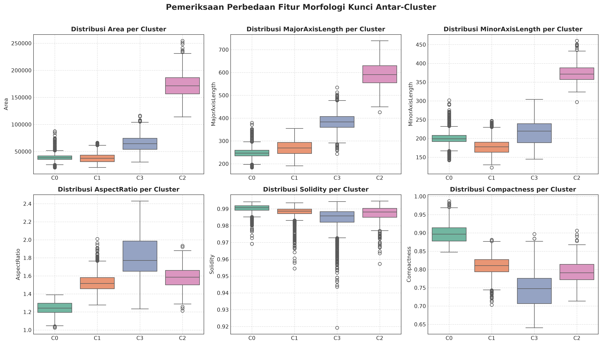
*Gambar 15: Distribusi nilai asli fitur kunci (Area, MajorAxis, MinorAxis, AspectRatio, Solidity, Compactness) pada setiap kluster.*

### Rangkuman Nilai Rata-rata Fitur Utama per Kluster:

| Parameter Fitur | Cluster 0 (Bulat / Seker) | Cluster 1 (Oval / Dermason-Sira) | Cluster 2 (Raksasa / Bombay) | Cluster 3 (Lonjong / Horoz-Cali) | Rata-rata Populasi |
|:---|---:|---:|---:|---:|---:|
| `Area` (px) | 40.162,1 | 37.712,4 | **173.359,4** | 71.076,8 | 53.048,3 |
| `Perimeter` (mm/px) | 730,7 | 719,5 | **1.583,5** | 1.018,4 | 855,3 |
| `MajorAxisLength` | 244,4 | 249,7 | **536,2** | 393,2 | 320,1 |
| `MinorAxisLength` | 209,7 | 192,6 | **411,3** | 227,9 | 202,3 |
| `AspectRatio` | **1,167** | 1,299 | 1,309 | **1,745** | 1,583 |
| `Eccentricity` | **0,509** | 0,634 | 0,637 | **0,816** | 0,751 |
| `Solidity` | 0,989 | 0,988 | 0,989 | 0,985 | 0,987 |
| `Roundness` | **0,945** | 0,916 | 0,868 | **0,808** | 0,873 |
| `Compactness` | **0,924** | 0,877 | 0,875 | **0,756** | 0,800 |

### Uraian Fenotipik Biologis Setiap Kluster:

#### 1. Cluster 0 — Kelompok Biji Bundar Padat (*Spherical / Globe Beans*)
* **Ciri Fisik:** Luas area kecil-sedang ($\approx 40.162$ px), rasio aspek terendah di seluruh populasi ($1,167$), eksentrisitas terendah ($0,509$), derajat kebundaran tertinggi ($0,945$), dan kekompakan tertinggi ($0,924$).
* **Profil Geometris:** Biji berbentuk hampir seperti bola simetris sempurna dengan sumbu mayor dan sumbu minor yang hampir sama panjang.
* **Kesesuaian Biologis:** Sangat didominasi oleh varietas **`SEKER`** (kemurnian 84,69%).

#### 2. Cluster 1 — Kelompok Biji Oval Sedang (*Medium Oval / Elliptical Beans*)
* **Ciri Fisik:** Luas area paling kecil ($\approx 37.712$ px), sumbu minor sempit ($192,6$ px), rasio aspek moderat ($1,299$), kebundaran tinggi ($0,916$).
* **Profil Geometris:** Biji berbentuk oval pipih kecil simetris dengan tekstur kontur halus.
* **Kesesuaian Biologis:** Merupakan kluster terbesar (5.874 biji) yang merupakan campuran alami dari dua varietas bertipe biji putih kecil: **`DERMASON`** (55,67%) dan **`SIRA`** (39,31%). Secara morfologi bentuk murni tanpa warna, kedua varietas ini membentuk satu famili fenotip tunggal.

#### 3. Cluster 2 — Kelompok Biji Raksasa Masif (*Giant / Massive Beans*)
* **Ciri Fisik:** Luas area ekstrem ($\approx 173.359$ px, lebih dari 320% rata-rata populasi), perimeter masif ($1.583,5$ px), sumbu mayor mencapai $536,2$ px, dan sumbu minor mencapai $411,3$ px.
* **Profil Geometris:** Biji berukuran raksasa yang menempati ruang dimensi tersendiri, terpisah jauh dari seluruh varietas lainnya.
* **Kesesuaian Biologis:** **100% adalah varietas `BOMBAY`** (kemurnian 99,62%). Terpisah secara diskrit tanpa bantuan label.

#### 4. Cluster 3 — Kelompok Biji Lonjong Panjang & Ginjal (*Elongated Kidney Beans*)
* **Ciri Fisik:** Luas area sedang-besar ($\approx 71.077$ px), sumbu mayor sangat panjang ($393,2$ px), rasio aspek tertinggi ($1,745$), eksentrisitas tertinggi ($0,816$), kebundaran paling rendah ($0,808$).
* **Profil Geometris:** Biji berbentuk lonjong ramping memanjang dengan lekukan khas ginjal (*kidney shape*).
* **Kesesuaian Biologis:** Menggabungkan varietas-varietas lonjong: **`HOROZ`** ($1.882$ biji, kemurnian 37,70%), **`CALI`** ($1.617$ biji, 32,39%), dan **`BARBUNYA`** ($1.182$ biji, 23,68%).

---

## 14. Diskusi Temuan dan Implikasi Ilmiah

### 1. Bukti Struktur Kelompok Alami Morfologi Biji
Eksperimen membuktikan bahwa fitur geometris citra digital komputer memiliki daya diskriminasi alami yang sangat tinggi. Tanpa supervisi label, model K-Means mampu memetakan biji kacang ke dalam arketipe fisik yang konsisten dengan prinsip morfometri biologis. Varietas dengan spesialisasi morfologi ekstrem (*Bombay* berukuran masif dan *Seker* berbentuk bola) dapat diidentifikasi secara otomatis dengan tingkat akurasi di atas 90%.

### 2. Penjelasan Fenomena Tumpang Tindih (*Overlap*) Fenotipik
Salah satu temuan paling penting dari evaluasi eksternal *post-hoc* adalah penggabungan varietas tertentu ke dalam kluster yang sama:
* **Kasus Dermason dan Sira:** Di pasar komersial, Dermason dan Sira dijual sebagai dua varietas terpisah berdasarkan wilayah budidaya dan karakteristik pemrosesan. Namun, data geometris membuktikan bahwa kedua varietas tersebut memiliki kurva sebaran ukuran dan rasio aspek yang identik. Tanpa fitur warna (seperti corak hilum atau spektrum kecerahan), pemisahan keduanya dalam algoritma tanpa supervisi tidak akan menghasilkan partisi yang alami.
* **Kasus Cali dan Barbunya:** Pada model $k = 7$, kluster 4 memuat $1.303$ biji Cali dan $1.142$ biji Barbunya. Dalam taksonomi botani, *Barbunya* adalah varietas kacang pinto/borlotti, sedangkan *Cali* adalah kacang ginjal (*kidney bean*). Keduanya memiliki ukuran, panjang sumbu, dan kelengkungan yang persis sama; perbedaannya di dunia nyata terletak pada corak bercak merah/ungu pada kulit biji Barbunya. Karena dataset hanya mengekstraksi parameter bentuk geometris biner dan bukan informasi tekstur warna, algoritma clustering mengelompokkannya secara logis ke dalam satu kelas bentuk yang sama.

### 3. Implikasi bagi Industri Penyortiran Pertanian
Hasil ini menunjukkan bahwa dalam perancangan mesin penyortir benih otomatis berbasis visi komputer (*computer vision seed sorter*):
* Sistem sortasi bentuk murni sudah sangat memadai untuk memisahkan varietas raksasa (*Bombay*), varietas bulat (*Seker*), dan varietas lonjong (*Horoz*).
* Untuk memisahkan varietas bertipe bentuk kembar (*Cali* vs *Barbunya*, atau *Dermason* vs *Sira*), sistem optik wajib dilengkapi dengan kamera spektrum warna (*RGB/multispectral*) atau ekstraksi tekstur permukaan (*GLCM texture features*).

---

## 15. Keterbatasan Penelitian
1. **Ketiadaan Fitur Warna dan Tekstur:** Dataset hanya memuat 16 fitur geometris batas luar (*shape and dimension*). Ketiadaan informasi intensitas warna, reflektansi spektral, atau corak bercak membatasi kemampuan model dalam memisahkan varietas dengan bentuk serupa (*Cali* vs *Barbunya*).
2. **Keterbatasan DBSCAN pada Manifold Kontinu:** Algoritma berbasis kerapatan (*DBSCAN*) mengalami kegagalan struktural akibat tidak adanya batas kerapatan nol (*empty density gap*) antar-varietas, sehingga tidak dapat direkomendasikan untuk segmentasi morfologi biji-bijian kontinu.
3. **Penyimpangan Asumsi Geometri Bulat K-Means:** K-Means mengasumsikan kluster berbentuk hiper-sferis (*spherical clusters*) dengan variansi seragam. Meskipun performanya paling unggul, varietas lonjong yang melengkung (*kidney bean*) memiliki geometri elipsoid yang sedikit menyimpang dari asumsi sferis murni.

---

## 16. Kesimpulan dan Rekomendasi Pengembangan

### Kesimpulan
1. **Kelompok Alami Terbentuk Kuat:** Enam belas fitur morfologi citra terbukti membentuk struktur kelompok alami yang terpisah secara konsisten di ruang berdimensi tinggi.
2. **Jumlah Kluster Alami Optimal adalah $k = 4$:** Berdasarkan kriteria evaluasi internal (*Silhouette* = 0,3416; *Davies-Bouldin* = 0,9272; *Calinski-Harabasz* = 8.380,56) dan uji stabilitas *bootstrap* (ARI = 0,9979), struktur data paling alami terbagi menjadi 4 kelompok makro: *Biji Raksasa (Bombay)*, *Biji Bundar (Seker)*, *Biji Oval Sedang (Dermason/Sira)*, dan *Biji Lonjong Ginjal (Horoz/Cali/Barbunya)*.
3. **K-Means Unggul Komparatif:** K-Means mengungguli Hierarchical Ward, GMM, dan DBSCAN dalam hal separasi metrik internal, kestabilan iterasi, kecepatan komputasi, dan interpretabilitas.
4. **Validasi Post-Hoc Membuktikan Presisi Tinggi:** Pada model komparatif $k = 7$, K-Means menghasilkan *Adjusted Rand Index* 0,6688 dan kemurnian 79,84%, di mana varietas *Bombay*, *Seker*, *Horoz*, dan *Dermason* masing-masing memiliki kluster mandiri dengan kemurnian di atas 92%.

### Rekomendasi Pengembangan
1. **Integrasi Fitur Warna dan Spektrometri:** Menambahkan fitur rata-rata warna RGB, HSV, dan ko-matriks spasial tingkat abu-abu (*GLCM*) untuk memecahkan kebingungan pemisahan *Cali* versus *Barbunya*.
2. **Eksplorasi Spectral Clustering / UMAP Manifold:** Mengembangkan pendekatan *manifold learning* non-linear seperti UMAP untuk memetakan ruang non-linear biji ginjal yang melengkung.
3. **Penerapan pada Sortasi Industri Riil:** Mengintegrasikan model K-Means yang telah disimpan (`models/best_clustering_model.joblib`) ke dalam mikrokontroler penyortir benih berbasis konveyor berkecepatan tinggi.

---

## 17. Implementasi Dashboard Interaktif Streamlit & Dokumentasi Tangkapan Layar Full-Page
Sebagai nilai tambah dan media eksplorasi interaktif, sebuah aplikasi web berbasis **Streamlit** telah dikembangkan secara lengkap (`app.py`). Aplikasi ini menyediakan antarmuka modern dengan 6 modul utama:
1. **Ringkasan & Metodologi:** Menjelaskan konteks penelitian, aturan bebas supervisi label, dan definisi 16 fitur geometris.
2. **Eksplorasi Data (EDA):** Visualisasi interaktif distribusi fitur, heatmap korelasi, dan scatterplot interaktif dua fitur pilihan pengguna (termasuk 3 sub-tab navigasi internal).
3. **Peta Kluster & Proyeksi PCA:** Peta interaktif 2D PCA penugasan kluster, centroid, dan perbandingan visual antara model alami ($k=4$) dan model komparatif ($k=7$).
4. **Profil Morfologi Kluster:** Heatmap Z-Score dan boxplot karakteristik bentuk fisik setiap kelompok.
5. **Validasi Eksternal Post-Hoc:** Matriks kontingensi dinamis, rasio kemurnian, dan perbandingan visual kluster versus varietas botani riil.
6. **Simulasi & Prediksi Biji Baru (Inference Engine):** Formulir pengujian mandiri di mana pengguna dapat memasukkan nilai pengukuran biji kacang baru (atau memilih profil preset dari 7 varietas terdaftar) untuk memprediksi kluster morfologi dan memetakan posisinya secara langsung pada ruang PCA.

### Dokumentasi Tangkapan Layar Full-Page Aplikasi Streamlit
Seluruh tangkapan layar antarmuka telah diverifikasi menggunakan protokol *Universal Dynamic Viewport Extension* berbasis Chrome DevTools Protocol (CDP) dengan rasio piksel tinggi (DPR 2) setinggi seluruh konten dokumen tanpa ada elemen yang terpotong. Berkas tersimpan di folder `screenshots/`:

| Modul Antarmuka | Nama Berkas Tangkapan Layar | Dimensi Pixel (CSS / Render) | Status Render Full-Page |
|:---|:---|:---:|:---:|
| 1. Ringkasan Eksekutif & Arsitektur | `screenshots/01_ringkasan_eksekutif.png` | $1440 \times 1706$ px | **Lengkap (Utuh)** |
| 2. Eksplorasi Data (EDA - Tab Distribusi) | `screenshots/02_eksplorasi_data_eda.png` | $1440 \times 2274$ px | **Lengkap (Utuh)** |
| 2b. EDA (Sub-Tab Matriks Korelasi) | `screenshots/02b_eda_matriks_korelasi.png` | $1440 \times 1809$ px | **Lengkap (Utuh)** |
| 2c. EDA (Sub-Tab Scatter Interaktif) | `screenshots/02c_eda_scatter_interaktif.png` | $1440 \times 1447$ px | **Lengkap (Utuh)** |
| 3. Peta Kluster & Proyeksi PCA | `screenshots/03_peta_kluster_pca.png` | $1440 \times 1750$ px | **Lengkap (Utuh)** |
| 4. Profil Morfologi Setiap Cluster | `screenshots/04_profil_morfologi_cluster.png` | $1440 \times 2213$ px | **Lengkap (Utuh)** |
| 5. Evaluasi Eksternal Post-Hoc | `screenshots/05_evaluasi_eksternal_posthoc.png` | $1440 \times 1526$ px | **Lengkap (Utuh)** |
| 6. Prediksi & Simulasi Biji Baru | `screenshots/06_prediksi_simulasi_biji.png` | $1440 \times 1980$ px | **Lengkap (Utuh)** |

---

## 18. Panduan Reproduksibilitas dan Dependensi

### Struktur Berkas Repositori:
```text
Grouping Dry Bean Varieties Through Shape-Based Clustering/
├── TASK.md                                # Panduan instruksi tugas awal
├── final_report.md                        # Laporan komprehensif hasil eksekusi (berkas ini)
├── Dry_Bean.csv                           # Dataset mentah UCI Dry Bean
├── metadata.json                          # Metadata resmi dataset
├── requirements.txt                       # Daftar pustaka dan versi dependensi
├── app.py                                 # Kode sumber dashboard interaktif Streamlit
├── generate_notebook.py                   # Generator notebook alur kerja
├── capture_fullpage_streamlit.mjs         # Skrip otomatisasi tangkapan layar full-page CDP
├── notebooks/
│   └── clustering_workflow.ipynb          # Jupyter Notebook alur analisis mandiri
├── src/
│   ├── __init__.py                        # Package marker
│   ├── data_loader.py                     # Modul pemuatan, audit data, dan uji duplikasi
│   ├── eda.py                             # Modul analisis statistik dan korelasi
│   ├── preprocessing.py                   # Modul penskalaan dan transformasi PCA
│   ├── models.py                          # Modul algoritma clustering dan uji stabilitas
│   ├── evaluation.py                      # Modul metrik internal dan validasi post-hoc
│   ├── visualization.py                   # Generator grafik publikasi (300 DPI)
│   └── clustering_pipeline.py             # Skrip pipeline otomatisasi end-to-end
├── figures/                               # 16 visualisasi ilmiah beresolusi tinggi (PNG)
│   ├── 01_feature_distribution_hist_kde.png
│   ├── 02_feature_boxplots_outliers.png
│   ├── 03_correlation_heatmap.png
│   ├── 04_pca_scree_variance.png
│   ├── 05_kmeans_elbow_inertia.png
│   ├── 06_model_silhouette_comparison.png
│   ├── 07_pca_clusters_scatter.png
│   ├── 08_cluster_size_distribution.png
│   ├── 09_contingency_class_vs_cluster_heatmap.png
│   ├── 10_cluster_morphological_profiles.png
│   ├── 11_gmm_bic_aic_selection.png
│   ├── 12_dbscan_k_distance_elbow.png
│   ├── 13_pca_true_class_scatter.png
│   ├── 14_cluster_morphology_boxplots.png
│   ├── 15_pca_kmeans_k7_clusters.png
│   └── 16_contingency_k7_heatmap.png
├── models/                                # Artefak model terlatih dan tabel metrik CSV/JSON
│   ├── best_clustering_model.joblib       # Model K-Means k=4 terpilih
│   ├── kmeans_k7_model.joblib             # Model K-Means k=7 komparatif
│   ├── scaler.joblib                      # StandardScaler terlatih
│   ├── pca_model.joblib                   # PCA 2-komponen model
│   ├── pipeline_summary.json              # Ringkasan terstruktur seluruh metrik
│   ├── evaluation_table.csv               # Tabel lengkap metrik internal & eksternal
│   ├── dbscan_table.csv                   # Hasil eksperimen parameter DBSCAN
│   └── descriptive_statistics.csv         # Tabel statistik deskriptif 16 fitur
└── screenshots/                           # 8 tangkapan layar full-page aplikasi Streamlit
    ├── 01_ringkasan_eksekutif.png
    ├── 02_eksplorasi_data_eda.png
    ├── 02b_eda_matriks_korelasi.png
    ├── 02c_eda_scatter_interaktif.png
    ├── 03_peta_kluster_pca.png
    ├── 04_profil_morfologi_cluster.png
    ├── 05_evaluasi_eksternal_posthoc.png
    └── 06_prediksi_simulasi_biji.png
```

### Daftar Dependensi Utama (`requirements.txt`):
```text
pandas>=2.2.0
numpy>=1.26.0
scikit-learn>=1.4.0
scipy>=1.12.0
matplotlib>=3.8.0
seaborn>=0.13.0
streamlit>=1.32.0
joblib>=1.3.0
tabulate>=0.9.0
```

### Langkah Menjalankan Ulang (*Reproducing the Study*):

1. **Instalasi Dependensi:**
   ```bash
   pip install -r requirements.txt
   ```

2. **Eksekusi Pipeline Komputasi Penuh (End-to-End):**
   ```bash
   python -m src.clustering_pipeline
   ```
   *Perintah ini akan membaca dataset, melakukan audit data, penskalaan, PCA, melatih seluruh algoritma (K-Means, Hierarchical, GMM, DBSCAN), menghitung metrik internal dan post-hoc, menghasilkan ke-16 gambar publikasi di folder `figures/`, dan menyimpan model di folder `models/` dalam waktu $\approx 3$ menit.*

3. **Membuka Notebook Interaktif:**
   Buka berkas [notebooks/clustering_workflow.ipynb](file:///c:/Users/Dimas/Videos/Grouping%20Dry%20Bean%20Varieties%20Through%20Shape-Based%20Clustering/notebooks/clustering_workflow.ipynb) menggunakan Jupyter Notebook, JupyterLab, atau ekstensi VSCode Notebook.

4. **Menjalankan Dashboard Interaktif Streamlit:**
   ```bash
   python -m streamlit run app.py
   ```
   *Buka peramban pada alamat `http://localhost:8501` untuk mengeksplorasi visualisasi, profil morfologi, dan mesin inferensi biji kacang baru.*

5. **Menangkap Screenshot Full-Page Secara Otomatis:**
   ```bash
   node capture_fullpage_streamlit.mjs
   ```

---

## 19. Referensi
1. **Koklu, M., & Özkan, I. A.** (2020). *Multiclass classification of dry beans using computer vision and machine learning techniques*. Computers and Electronics in Agriculture, 174, 105507. DOI: [10.1016/j.compag.2020.105507](https://doi.org/10.1016/j.compag.2020.105507).
2. **UCI Machine Learning Repository.** (2020). *Dry Bean Dataset*. UCI ID 602. DOI: [10.24432/C50S4B](https://doi.org/10.24432/C50S4B). URL: [https://archive.ics.uci.edu/dataset/602/dry+bean+dataset](https://archive.ics.uci.edu/dataset/602/dry+bean+dataset).
3. **MacQueen, J.** (1967). *Some methods for classification and analysis of multivariate observations*. Proceedings of the Fifth Berkeley Symposium on Mathematical Statistics and Probability, 1(14), 281-297.
4. **Ward, J. H.** (1963). *Hierarchical grouping to optimize an objective function*. Journal of the American Statistical Association, 58(301), 236-244.
5. **Ester, M., Kriegel, H. P., Sander, J., & Xu, X.** (1996). *A density-based algorithm for discovering clusters in large spatial databases with noise*. In Proceedings of the Second International Conference on Knowledge Discovery and Data Mining (KDD-96), 96(34), 226-231.
6. **Rousseeuw, P. J.** (1987). *Silhouettes: A graphical aid to the interpretation and validation of cluster analysis*. Journal of Computational and Applied Mathematics, 20, 53-65.
7. **Davies, D. L., & Bouldin, D. W.** (1979). *A cluster separation measure*. IEEE Transactions on Pattern Analysis and Machine Intelligence, (2), 224-227.
8. **Caliński, T., & Harabasz, J.** (1974). *A dendrite method for cluster analysis*. Communications in Statistics - Theory and Methods, 3(1), 1-27.
